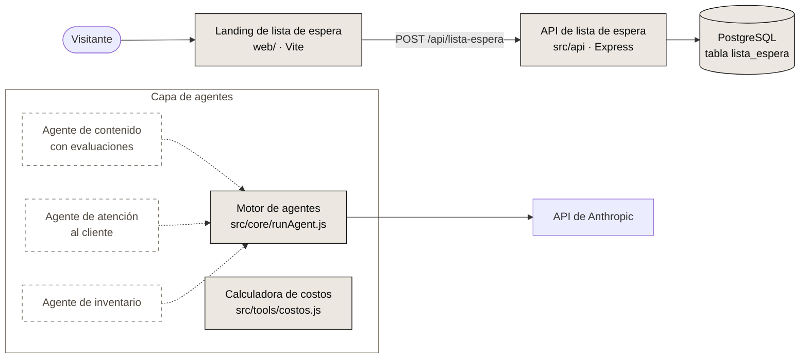

# VOW

Demo de la landing: https://vow-17x.pages.dev

[](https://github.com/FacundoGuiraldes/vow/actions/workflows/tests.yml)

VOW es una marca argentina de ropa y accesorios de gym que vende directo al público. Está en construcción, con lanzamiento previsto para 2027.

Este repositorio contiene el backend y la capa de agentes de IA de la marca. En `web/` también vive la landing de la lista de espera.

## Qué funciona hoy

- **API de lista de espera:** `POST /api/lista-espera` recibe `{ email, instagram, origen }`, valida y normaliza los datos y guarda el registro. `instagram` es opcional: se guarda sin "@", en minúsculas, y tiene que tener de 1 a 30 letras, números, puntos o guiones bajos. `GET /api/salud` responde `{ "ok": true }` sin consultar la base.
- **Conexión a PostgreSQL (Neon):** pool de conexiones, script de prueba y migración de la tabla `lista_espera`.
- **Motor de agentes:** ejecuta agentes sobre el SDK de Anthropic con soporte para herramientas, límite de turnos y conteo de tokens.
- **Calculadora de costos:** calcula el costo de importación por unidad y el margen a partir de los datos de una orden. Todavía no incluye IVA de importación ni Ingresos Brutos, que quedan pendientes de confirmar con un contador.
- **Tests y CI:** 16 tests automáticos que corren en GitHub Actions con cada push.

## Arquitectura



Los bloques con borde continuo ya existen en el repo. Los bloques con borde punteado están planificados. La landing está publicada en Cloudflare Pages y la API en Render (plan gratuito), con la base de datos en Neon. Por el plan gratuito, el primer pedido después de un rato sin tráfico puede tardar cerca de un minuto; para acortar esa espera, la landing despierta la API al cargar.

## Stack

| Capa | Tecnología |
|---|---|
| Runtime | Node.js |
| API | Express |
| Base de datos | PostgreSQL (Neon) |
| Landing | Vite |
| Agentes | SDK de Anthropic |
| CI | GitHub Actions |

## Cómo correrlo

### Requisitos

- Node.js 24 (la misma versión mayor que usa la CI) y npm.
- Una base de datos PostgreSQL accesible por URL.
- Una API key de Anthropic, solo para los scripts de agentes.

### Instalación

```bash
git clone https://github.com/FacundoGuiraldes/vow.git
cd vow
npm ci
cd web && npm ci && cd ..
```

### Variables de entorno

Copiá la plantilla y completá los valores en `.env`. El archivo `.env` está en `.gitignore` y nunca se sube al repo.

```bash
cp .env.example .env
```

| Variable | Para qué sirve |
|---|---|
| `ANTHROPIC_API_KEY` | Clave de la API de Anthropic. La usan el motor de agentes y los scripts `hola` y `prueba`. |
| `DATABASE_URL` | Cadena de conexión a PostgreSQL. La usan la API, la migración y los tests de la API. |
| `ALLOWED_ORIGINS` | Orígenes que pueden llamar a la API desde el navegador, separados por coma. En desarrollo tiene que incluir la dirección donde corre Vite. Si queda vacía, ningún sitio puede llamar a la API. |
| `VITE_API_URL` | URL base de la API que usa la landing. Si queda vacía, la landing llama a `/api/lista-espera` en su mismo dominio. |
| `TRUST_PROXY` | Se activa con `1` solo cuando la API corre detrás de un proxy. Así el límite de pedidos usa la IP real del visitante (`X-Forwarded-For`) y no la del proxy. En local se deja vacía. |

La API también acepta `PORT`, que es opcional (por defecto 3000). La landing lee el mismo `.env` de la raíz, y Vite solo expone al navegador las variables que empiezan con `VITE_`.

### Primer arranque

```bash
npm run db-probar
npm run db-migrar
npm run servidor
```

En otra terminal, para la landing:

```bash
cd web
npm run dev
```

### Scripts

| Script | Qué hace |
|---|---|
| `npm test` | Corre todos los tests con `node --test`. |
| `npm run servidor` | Levanta la API de lista de espera. |
| `npm run db-probar` | Verifica la conexión a la base y muestra la versión de PostgreSQL. |
| `npm run db-migrar` | Crea la tabla `lista_espera` si no existe y agrega las columnas nuevas a una tabla existente. Se puede correr más de una vez. |
| `npm run costos` | Corre la calculadora de costos con un caso de ejemplo. |
| `npm run hola` | Pide un eslogan a la API de Anthropic. Hace una llamada real y consume crédito. |
| `npm run prueba` | Corre el agente de prueba sobre el motor de agentes. Hace una llamada real y consume crédito. |

Dentro de `web/`: `npm run dev`, `npm run build` y `npm run preview`.

### Tests

```bash
npm test
```

Son 16 tests: 3 de la calculadora de costos y 13 de la API. Los de la API necesitan `DATABASE_URL`, crean la tabla si no existe y usan emails descartables bajo un dominio `.invalid`. Al terminar, borran los registros que crearon.

En GitHub Actions corren con cada push. La CI toma `DATABASE_URL` de un secreto del repositorio.

## Decisiones de diseño

- **Consultas parametrizadas:** todo el SQL usa parámetros (`$1`, `$2`) y nunca concatena texto, para evitar inyección SQL.
- **Respuesta idéntica para emails repetidos:** un email nuevo y uno ya anotado reciben el mismo `200` y el mismo mensaje, así nadie puede averiguar quién está en la lista.
- **Límite de pedidos por IP:** 5 pedidos por minuto en el endpoint de la lista de espera. `GET /api/salud` no cuenta para el límite.
- **CORS restringido:** solo responden a los orígenes definidos en `ALLOWED_ORIGINS`.
- **Datos descartables en los tests:** los tests usan emails que no pueden existir y los borran al terminar, sin tocar registros reales.

## Hoja de ruta

- [x] Publicar la API y la landing.
- [ ] Agente de contenido con evaluaciones.
- [ ] Agente de atención al cliente.
- [ ] Agente de inventario.
