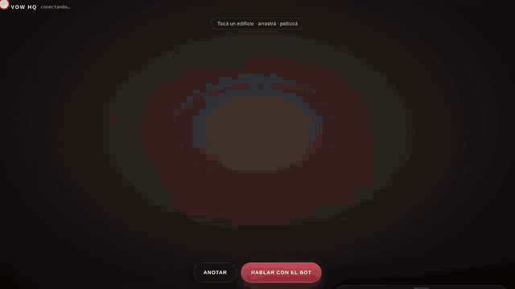
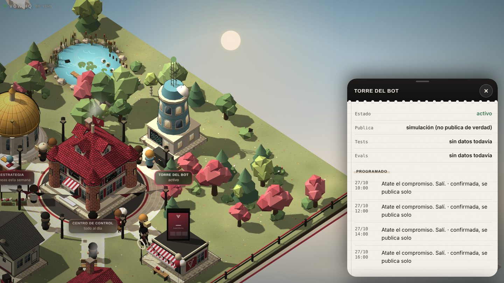
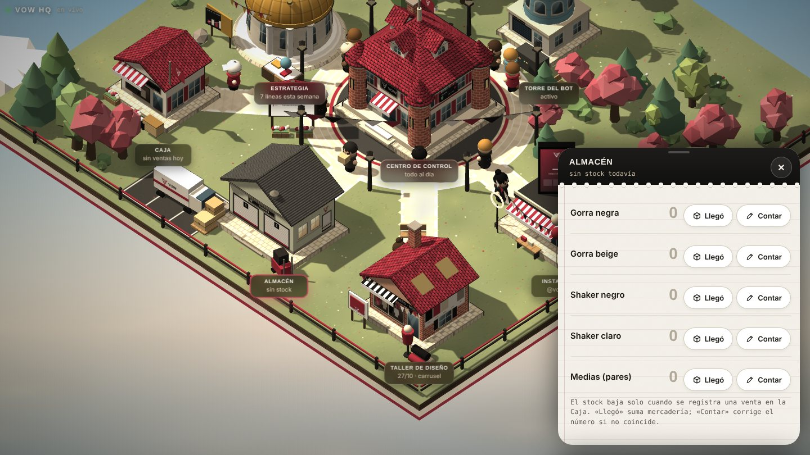
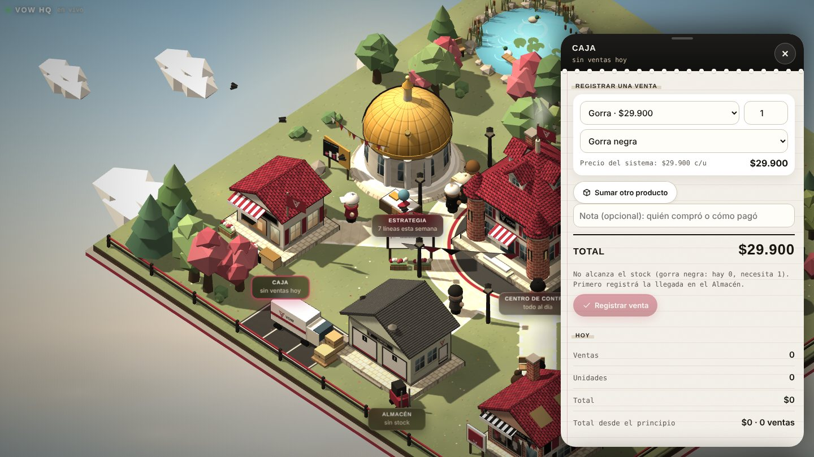
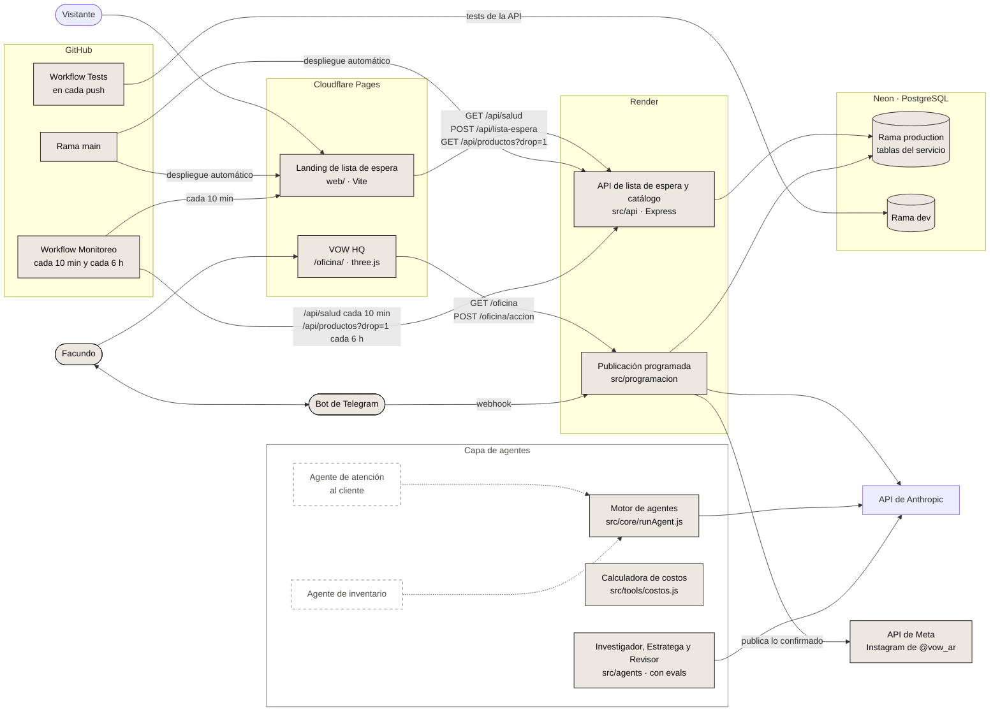
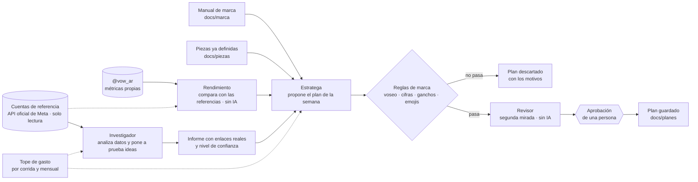

# VOW

- **Landing:** https://vow-17x.pages.dev
- **API:** `https://vow-2i0f.onrender.com` (por ejemplo, [`/api/salud`](https://vow-2i0f.onrender.com/api/salud) o [`/api/productos?drop=1`](https://vow-2i0f.onrender.com/api/productos?drop=1))

[](https://github.com/FacundoGuiraldes/vow/actions/workflows/tests.yml)
[](https://github.com/FacundoGuiraldes/vow/actions/workflows/monitoreo.yml)


VOW es una marca argentina de ropa y accesorios de gym que vende directo al público. Está en construcción: el primer lanzamiento es el **Drop 00** (stock real, venta propia con Mercado Pago, hoy lista pero sin abrir al público) y después viene el **Drop 01**. Todo lo que falta y el orden del día de lanzamiento está en [`docs/lanzamiento.md`](docs/lanzamiento.md).

Este repositorio es la base técnica de la marca:

- **Landing y API** (`web/`, `src/api`): lista de espera y catálogo del Drop 01, publicados y monitoreados.
- **Tienda propia (Drop 00):** carrito en la landing, pago con Mercado Pago, stock que se descuenta solo y códigos de descuento para la lista de espera. [Ver cómo funciona](#venta-propia-con-mercado-pago).
- **Un sistema de agentes de IA** que investiga cuentas de referencia y propone el plan de contenido semanal, siempre con reglas de marca, tope de gasto y aprobación de una persona antes de seguir. [Ver cómo funciona](#el-sistema-de-agentes).
- **Publicación programada de Instagram con un bot de Telegram:** el plan de la semana llega al chat, cada pieza se aprueba, se confirma el mismo día y recién ahí se publica sola. [Ver cómo funciona](#publicación-programada-de-instagram-telegram).
- **VOW HQ:** el panel de control del sistema, hecho como una aldea isométrica en 3D donde cada edificio es un área real (piezas, bot, estrategia, stock y ventas). [Verlo](#vow-hq-el-sistema-como-un-juego).
- **Piezas de Instagram hechas con código**: láminas de carruseles y reels que se generan desde el repo, con el mismo sistema visual de la marca.

## VOW HQ: el sistema como un juego


**VOW HQ** es el panel de control de la marca, pero en vez de tablas y menús es una **aldea isométrica en 3D** (three.js, con ciclo de día y noche): cada edificio es un área real del sistema y todo lo que se ve está conectado en vivo con el servicio y con el bot de Telegram. Los globos rojos marcan lo que necesita la mirada de una persona. Se abre en [`/oficina/`](https://vow-17x.pages.dev/oficina/) de la web.



*Recorrido acelerado (datos de demostración). [Ver el video completo (54 s)](docs/img/hq/recorrido.mp4).*

### Qué hay en cada edificio

| Edificio | Para qué sirve |
|---|---|
| **Centro de control** | Muestra solo lo pendiente (piezas por aprobar o confirmar) y deja anotarle algo al bot. |
| **Taller de diseño** | Las piezas de Instagram por salir: se aprueban, se editan a mano, se les carga la foto o el video, o se le pide a la IA otra sugerencia. Al confirmar una pieza del día muestra **cómo queda en Instagram** antes de que se suba. |
| **Torre del bot** | Estado del bot y de la publicación (simulación o real), tests y evals, y la charla reciente con el bot. |
| **Estrategia** | Las líneas de la semana que salieron de la última investigación. Se pueden editar, quitar, agregar o restaurar hasta el lunes. |
| **Instagram** | Rendimiento de @vow_ar (alcance, guardados, compartidos) cuando la cuenta está conectada al servicio. |
| **Almacén** | Stock por producto (gorras, shakers y medias). Arranca en 0 hasta registrar la llegada de la mercadería. |
| **Caja** | Registro de ventas: descuentan el stock solas y se pueden anular. **Los precios los fija el sistema** y el juego no los puede cambiar. |

### Previsualización realista antes de publicar

Al confirmar una pieza para el día, el HQ arma una maqueta del teléfono con el archivo real y el epígrafe, tal como se vería en Instagram (publicación, carrusel, reel o historia). Además chequea el archivo: si la proporción se va a recortar o a verse con bandas, si el epígrafe es muy largo, si faltan archivos o si un carrusel mezcla proporciones. En las historias se puede activar una guía con las zonas que Instagram tapa con su interfaz.


### Una sola fuente de verdad

Lo que se hace en el juego y lo que se dice en el chat del bot es lo mismo: las dos cosas llaman a las mismas herramientas del servicio (ver stock, registrar una llegada o una venta, editar la estrategia, agregar eventos a la agenda, aprobar una pieza, y más). Todo se guarda en la base, le llega al Estratega como novedad para el próximo plan y el workflow `Sincronizar operación` lo copia cada 30 minutos a [`docs/operacion/`](docs/operacion/).

<table>
<tr>
<td width="50%"><br><sub>Estrategia: líneas de la semana, editables hasta el lunes.</sub></td>
<td width="50%"><br><sub>Torre del bot: estado, publicación en simulación y lo programado.</sub></td>
</tr>
<tr>
<td width="50%"><br><sub>Almacén: stock por producto, con «Llegó» y «Contar».</sub></td>
<td width="50%"><br><sub>Caja: el precio sale del sistema; avisa si no alcanza el stock.</sub></td>
</tr>
</table>

### Qué cuida

- **La IA propone, una persona decide:** aprobar una pieza desde el juego equivale al botón de Telegram, pero **la confirmación final del día sigue siendo solo por Telegram**. Cualquier edición o archivo nuevo borra la confirmación.
- **Precios solo desde el sistema:** el catálogo vive en `CATALOGO` (`src/programacion/inventario.js`) y el servidor rechaza cualquier precio que mande el juego.
- **Con clave:** las rutas del juego piden `OFICINA_SECRETO` (o `PROGRAMACION_SECRETO` si no está definida). La clave se escribe una vez y queda en ese navegador.
- **Los cambios largos no cuelgan el juego:** pedirle otra sugerencia a la IA tarda, así que el servidor contesta enseguida y el avance (`trabajando`, `listo` o `error` con el motivo) viaja en el campo `cambios`; el juego lo muestra solo.

### Cómo funciona por dentro

- **Lectura:** el juego consulta `GET /api/programacion/oficina?v=<versión>` cada 3 segundos (piezas con sus archivos, charla reciente con el bot, novedades, lo marcado en el juego y rendimiento de Instagram). Si no cambió nada, el servidor contesta cortito.
- **Acciones:** `POST /api/programacion/oficina/accion` con `aprobar_pieza`, `cambiar_pieza`, `editar_pieza`, `quitar_archivos`, `cumplir`, `deshacer`, `nota`, `quitar_nota`, `inventario` (`entrada`, `ajuste`, `venta`, `anular_venta`) y `operacion` (tipos `estrategia_*` y datos editables).
- **Archivos:** `POST /api/programacion/oficina/archivo?id=<pieza>` recibe como cuerpo la foto JPEG o el video MP4/MOV (hasta 40 MB) que se va a publicar.
- **Documentos del repo:** `scripts/generar-oficina.js` arma los datos de estrategia, piezas y depósito, y la API los entrega solo con clave (`GET /api/programacion/oficina/documentos`); no están en la web pública; el estado de tests y evals sale de la API pública de GitHub.
- **CORS:** la web tiene que estar en `ALLOWED_ORIGINS`.
- **Cómo se edita el juego:** las fuentes están en [`web/fuentes-oficina/`](web/fuentes-oficina/) (partes JS y HTML) y se ensamblan con `python3 web/fuentes-oficina/asm.py`, que regenera `web/public/oficina/index.html`. Ese archivo es generado: no se edita a mano. Necesita three.js r128, que se carga desde cdnjs.

## Qué demuestra este proyecto

La parte difícil de usar IA en serio no es llamarla, es **poder confiar en lo que devuelve**. Por eso la mayor parte del trabajo está en controlarla y medirla:

- **Reglas que se pueden probar:** la marca tiene un manual (`docs/marca/cerebro-de-marca.md`) y sus reglas están en código, no solo en un prompt. Frenan datos inventados, frases fuera de tono y ganchos repetidos.
- **Evals con un número:** hay casos fijos que corren gratis en cada cambio y una corrida con la IA real que mide qué porcentaje de planes cumple las reglas y cuánto cuesta cada uno.
- **Tests que prueban a los tests:** el mutation testing (romper el código a propósito y comprobar que algún test lo detecte) se aplicó a mano en las partes críticas, como las reglas de marca (ver `evals/README.md`). No corre automáticamente en el CI: ahí solo corre `npm test`.
- **Control del gasto:** tope por corrida, tope mensual y modo simulado que prueba todo el flujo sin gastar.
- **La IA propone, una persona decide:** ningún agente publica por su cuenta. Una pieza solo sale si una persona la confirma el mismo día, y sin esa confirmación no se publica nada.

## Qué funciona hoy

- **API de lista de espera:** `POST /api/lista-espera` recibe `{ email, instagram, origen }`, valida y normaliza los datos y guarda el registro. `instagram` es opcional: se guarda sin "@", en minúsculas, y tiene que tener de 1 a 30 letras, números, puntos o guiones bajos. `GET /api/salud` responde `{ "ok": true }` sin consultar la base.
- **Catálogo del Drop 01:** tabla `productos` con los 7 productos del Drop 01 en estado concepto, cargados con el script `db-seed`. `GET /api/productos` y `GET /api/productos/:slug` los exponen sin precios, stock ni datos internos.
- **Sección Drop 01 en la landing:** muestra la imagen conceptual del drop y el listado que trae de la API, con avisos mientras el servidor despierta y si la carga falla.
- **Conexión a PostgreSQL (Neon):** pool de conexiones, script de prueba y migración de las tablas `lista_espera` y `productos`.
- **Rendimiento propio:** `npm run rendimiento` mide las publicaciones de @vow_ar (alcance, guardados, compartidos) y las compara con las cuentas de referencia, sin IA. El Estratega lee el último informe.
- **Tienda propia con Mercado Pago:** pedido calculado por el servidor, Checkout Pro, aviso firmado que descuenta el stock una sola vez y reserva del código mientras se paga. Está terminada y probada con un Mercado Pago simulado; la venta sigue cerrada hasta el lanzamiento (`VENTA_ABIERTA`). Detalle en [Venta propia](#venta-propia-con-mercado-pago).
- **Descuento para la lista de espera:** código único del 10 % por persona y por drop, mail con diseño de VOW desde Gmail, y "Consultá tu código" en la tienda como alternativa si el mail cae en spam.
- **Publicación programada por Telegram:** el bot manda el plan, recuerda qué filmar, pide la confirmación del día y publica solo lo confirmado (imágenes, carruseles, reels e historias). Detalle en [Publicación programada](#publicación-programada-de-instagram-telegram).
- **VOW HQ:** el panel de control en forma de juego, con Taller de diseño, previsualización realista de Instagram, Estrategia, Almacén y Caja conectados al bot. Detalle en [VOW HQ](#vow-hq-el-sistema-como-un-juego).
- **Sistema de agentes:** Investigador, Estratega y Revisor, coordinados por un orquestador que frena donde hace falta una persona. Detalle en [El sistema de agentes](#el-sistema-de-agentes).
- **Reglas de marca en código:** voseo, palabras y frases prohibidas, máximo de emojis, y toda cifra tiene que existir en los datos cargados.
- **Evals offline y online:** 145 casos gratis en el CI y una corrida con la IA real contra una línea base. Detalle en [Cómo sé que funciona](#cómo-sé-que-funciona).
- **Tope de gasto:** por corrida y mensual (`TOPE_MENSUAL_USD`), con `npm run gasto` para ver cuánto va del mes.
- **Piezas de Instagram por código:** láminas de carruseles (`npm run laminas`) y reels animados (`npm run reel:logo`) generados con Playwright y ffmpeg, más la foto de perfil. Las piezas definidas viven en `docs/piezas/`.
- **Motor de agentes base:** `src/core/runAgent.js` ejecuta agentes sobre el SDK de Anthropic con herramientas, límite de turnos y conteo de tokens.
- **Calculadora de costos:** calcula el costo de importación por unidad y el margen a partir de los datos de una orden. Todavía no incluye IVA de importación ni Ingresos Brutos, que quedan pendientes de confirmar con un contador.
- **Tests y CI:** más de 500 tests automáticos (`node --test`) que corren en GitHub Actions con cada push. Los que necesitan base de datos se saltean si no hay `DATABASE_URL`, pero en el CI fallan si falta.
- **Tests e2e:** suite de Playwright en TypeScript (smoke, funcionales con la API simulada, accesibilidad con axe e integración contra la base `dev`) en cuatro navegadores.
- **Monitoreo:** un workflow programado revisa cada 10 minutos que la landing y `GET /api/salud` respondan, y cada 6 horas que el catálogo del Drop 01 devuelva productos.
- **Entorno de desarrollo:** configuración de GitHub Codespaces que instala las dependencias y levanta la API y la landing al arrancar.

## Arquitectura



Los bloques con borde continuo ya existen en el repo. Los bloques con borde punteado están planificados.

## El sistema de agentes

Hoy cubre una tarea concreta: **decidir qué publicar cada semana en @vow_ar**, apoyándose en datos reales y en el manual de marca.



| Pieza | Qué hace | Qué no hace |
|---|---|---|
| **Investigador** (`src/agents/investigador.js`) | Lee datos públicos de cuentas de referencia, calcula el rendimiento con la mediana y mide cada publicación contra el tamaño de su cuenta. Pone a prueba hipótesis de formato. | Afirmar algo que los datos no sostienen: cada conclusión cita publicaciones reales y dice qué tan segura es. No cambia al Estratega por su cuenta. |
| **Rendimiento** (`src/agents/rendimiento.js`) | Mide las publicaciones de @vow_ar con sus métricas privadas (alcance, guardados, compartidos, interacciones sobre alcance) y las compara por tipo con la mediana de las cuentas de referencia. Avisa cuando la muestra es chica, cuando una publicación es reciente o cuando los seguidores pueden no ser reales. No usa IA ni gasta. | Sacar conclusiones con pocas publicaciones: con menos de 3 de un tipo, marca "muestra muy chica". |
| **Estratega** (`src/agents/estratega.js`) | Propone las piezas de una semana (gancho, guion, epígrafe, llamado a la acción, justificación), sin repetir lo que ya está definido. | Publicar. Propone y nada más. |
| **Revisor** (`src/agents/revisor.js`) | Vuelve a pasar un plan por las mismas reglas con el contexto de hoy: un plan editado a mano, uno viejo o una pieza definida después. No usa IA ni gasta. | Aprobar solo: la aprobación es de una persona. |
| **Orquestador** (`src/orquestador`) | Ejecuta los pasos en orden, guarda lo que hizo cada uno (`docs/ejecuciones/`), cuenta el gasto y no repite un paso que ya terminó. Un paso que falla frena el flujo. | Saber nada de Instagram ni de Claude: solo ordena pasos. |

Cómo se usa:

```bash
npm run rendimiento                                   # mide @vow_ar contra las referencias (sin IA, conviene antes de planificar)
npm run semana -- --semana 2026-11-02 --simulado      # prueba todo el flujo sin gastar
npm run semana -- --semana 2026-11-02                 # con la IA real: planifica y revisa, y se frena en la aprobación
npm run semana -- --semana 2026-11-02 --aprobar aprobar-plan   # aprueba; al volver a correr se guarda el plan
```

Qué cuida el sistema para que la IA no se descontrole:

- **Nada de datos inventados:** toda cifra de un texto tiene que existir en los datos cargados. Hoy solo existen "01" (de Drop 01) y "2027". Las medidas de armado de una pieza ("carrusel de 6 láminas") se permiten solo en el guion.
- **Tono de marca verificable:** las reglas de `src/agents/reglas-marca.js` detectan voseo mal usado, motivación vacía, exceso de emojis y ganchos copiados de otras cuentas.
- **Los errores dicen dónde están:** un rechazo por una cifra muestra la frase donde aparece, para decidir si fue un error real o una regla demasiado estricta.
- **Gasto acotado:** `--tope-usd` por corrida y un tope mensual que corta antes de llamar a la API (se configura con `TOPE_MENSUAL_USD`, por defecto US$ 5). Con `--simulado` ningún comando gasta.
- **Todo a mano:** los workflows que usan la IA solo se lanzan manualmente desde Actions.

### Conector de Instagram (MCP)

Un servidor [MCP](https://modelcontextprotocol.io) en `src/mcp/instagram/` conecta Claude Code con la cuenta de @vow_ar por la API oficial de Meta. Está registrado en [`.mcp.json`](.mcp.json): al abrir Claude Code en el repo, aparece como `vow-instagram` (la primera vez pide aprobarlo).

| Herramienta | Qué hace |
|---|---|
| `perfil`, `publicaciones` | Datos de la cuenta y últimas publicaciones con likes y comentarios. |
| `metricas_publicacion` | Alcance, vistas, guardados, compartidos e interacciones de una publicación. |
| `comentarios` | Comentarios de una publicación. |
| `preparar_publicacion` | Valida el texto, chequea el cupo diario de Meta y crea el contenedor de una imagen, un reel o un carrusel. **No publica.** |
| `publicar` | Publica un contenedor ya preparado. Exige `confirmar: true`. |
| `responder_comentario` | Responde un comentario. Exige `confirmar: true`. |

Qué cuida:

- **Solo lectura por defecto:** publicar y responder están apagados salvo `INSTAGRAM_PERMITIR_PUBLICAR=1`. Además, Claude Code pide permiso antes de cada herramienta.
- **Publicar lleva dos pasos:** preparar (se puede revisar) y publicar con confirmación, solo si Meta terminó de procesar el archivo.
- **Las mismas reglas de marca que el Estratega:** un epígrafe o una respuesta con urgencia falsa, sin voseo o con una cifra inventada se rechaza antes de llamar a Meta.
- **El token nunca aparece** en respuestas ni en errores, y en los pedidos de escritura viaja en el cuerpo, no en la dirección.
- **Archivos por dirección pública:** Meta descarga las imágenes (solo JPEG) y los videos desde una dirección `https` pública; no acepta archivos locales.

Para usarlo, la app de Meta necesita los permisos `instagram_basic`, `pages_show_list`, `pages_read_engagement` e `instagram_manage_insights` para leer, y además `instagram_content_publish` e `instagram_manage_comments` para publicar y responder. Se prueba con `node --test` y un Meta simulado: los tests no tocan la cuenta real.

## Cómo sé que funciona

Un sistema con IA no se prueba mirando una vez la salida. Hay tres capas:

1. **Tests** (`npm test`): más de 500 tests de reglas, agentes, orquestador, API y diseño, con la IA reemplazada por un cliente simulado.
2. **Evals offline** (`npm run evals`, gratis, en el CI): 145 casos fijos. Incluyen los falsos positivos reales que ya se corrigieron, para que no vuelvan, y una frase por cada palabra de cada regla de marca. Si una regla no tiene ningún caso que la dispare, el test falla.
3. **Evals online** (`npm run evals:online`, con la IA real): pide al Estratega seis pedidos distintos (con y sin producto, con y sin gente, distintas fases), mide el porcentaje que cumple las reglas, el costo por plan y qué reglas rechazan más, y lo compara con una línea base guardada. Última línea base: **6 de 6 aprobados, unos US$ 0,08 por plan.**

Además, en las partes críticas (reglas de marca) se aplicó **mutation testing** a mano: se rompe el código de a una cosa y se comprueba que algún test falle; los que no fallan se corrigen o se documentan como equivalentes. No está automatizado en el CI, que solo corre `npm test`.

Un ejemplo de cómo se ve en la práctica: una corrida online rechazó planes por la cifra "6". Con los errores que muestran la frase se vio que era "carrusel de 6 láminas", una medida de armado y no un dato inventado. La regla estaba siendo demasiado estricta; se corrigió solo para el guion, con tests que prueban que "3 días" o "5 straps" siguen siendo rechazados, y una nueva corrida dio 6 de 6. Los detalles de las evals están en [`evals/README.md`](evals/README.md).

## Publicación

| Parte | Dónde corre | URL |
|---|---|---|
| Landing (`web/`) | Cloudflare Pages | https://vow-17x.pages.dev |
| API (`src/api`) | Render, plan gratuito | `https://vow-2i0f.onrender.com` (la raíz no tiene ruta; probá [`/api/salud`](https://vow-2i0f.onrender.com/api/salud)) |
| Base de datos | Neon (PostgreSQL) | No es pública |

Cloudflare Pages y Render despliegan automáticamente cada vez que se actualiza `main`, así que todo lo que se mergea a `main` sale a producción.

Por el plan gratuito, Render apaga la API tras un rato sin tráfico y el primer pedido siguiente puede tardar cerca de un minuto. Para acortar esa espera, la landing despierta la API con `GET /api/salud` al cargar, y el workflow de monitoreo le pega cada 10 minutos.

### Ramas de la base en Neon

- **`production`:** la base que usa la API publicada.
- **`dev`:** la base para desarrollo y para los tests de la API, tanto en local como en la CI.

Como el despliegue desde `main` es automático, un cambio de esquema (tabla o columna nueva) se aplica primero en `production` con `npm run db-migrar` y recién después se mergea el código que lo usa. La migración solo crea lo que falta, así que se puede correr antes del merge sin romper la versión publicada.

## Endpoints de la API

| Método y ruta | Qué hace |
|---|---|
| `GET /api/salud` | Responde `{ "ok": true }` sin consultar la base. Sirve para despertar el servidor. |
| `POST /api/lista-espera` | Anota un email en la lista de espera, con Instagram opcional. Límite: 5 pedidos por minuto por IP. |
| `GET /api/productos` | Devuelve `{ "productos": [...] }` ordenados por drop y número. Acepta `?drop=N` (entero positivo); con otro valor responde 400. |
| `GET /api/productos/:slug` | Devuelve `{ "producto": {...} }`. El slug tiene que cumplir `^[a-z0-9-]{1,60}$` (si no, 400) y, si no existe, responde 404 con "Producto no encontrado". |

Los dos endpoints de productos responden con `Cache-Control: public, max-age=300` y tienen su propio límite de 60 pedidos por minuto por IP, separado del de la lista de espera. Solo exponen campos públicos: `drop_numero`, `numero`, `slug`, `nombre`, `categoria`, `descripcion`, `colores`, `destacado`, `estado` e `imagen`.

### Tabla `productos`

| Columna | Tipo y reglas |
|---|---|
| `id` | serial, clave primaria (no se expone en la API) |
| `drop_numero` | entero, por defecto 1 |
| `numero` | entero; único junto con `drop_numero` |
| `slug` | texto único |
| `nombre`, `descripcion` | texto |
| `categoria` | `ropa` o `accesorio` |
| `colores` | lista de textos |
| `destacado` | booleano, por defecto `false` |
| `estado` | `concepto`, `proximamente` o `disponible`; por defecto `concepto` |
| `imagen` | texto opcional; por ahora `null` |

La tabla no tiene columnas de precio, stock, material, gramaje ni medidas. Los datos del Drop 01 viven en `src/data/drop-01.js` y se cargan con `npm run db-seed`, que actualiza los productos existentes por `slug` y nunca borra registros.

## Publicación programada de Instagram (Telegram)

Flujo: el **lunes** el Estratega arma el plan de la semana y te llega por Telegram (una tarjeta por pieza, con qué filmar y cuándo te lo recuerdan). Podés **responder a cualquier tarjeta** para cambiarla, o escribir sin responder para pasarle una novedad de VOW al próximo plan. Todos los días a las **8:00** (Argentina) llega lo de hoy con la hora de publicación. Dos horas antes, si todavía no confirmaste, te llega un recordatorio. Si confirmás **ese mismo día**, el sistema publica a la hora; si no confirmás, **no se publica nada**.

- Recordatorio de filmación: 3 días antes de la fecha de la pieza (si el plan llega con menos margen, sale marcado como urgente).
- Seguridad: la confirmación vale solo el día en que se da; cualquier edición la borra; una publicación nunca se reintenta sola; si el sistema llega más de 20 minutos tarde, pregunta; `/pausar` y `/reanudar` frenan todo; sin `INSTAGRAM_PERMITIR_PUBLICAR=1` corre en simulación.
- **No se pierden mensajes:** el webhook guarda cada mensaje de Telegram en la base (`telegram_pendientes`) antes de contestarle OK a Telegram. Si el servidor se reinicia a mitad de camino, el mensaje queda pendiente y se vuelve a procesar solo (en el `tick` y a los 90 segundos de arrancar), hasta 3 intentos. El procesamiento es "al menos una vez": un mensaje recuperado podría correr de nuevo.
- **El plan semanal es todo o nada:** reemplazar el plan de una semana corre en una transacción, así que si una pieza falla no se cancela el plan anterior.
- Las historias se publican solas igual que las demás piezas (una foto o un video, sin epígrafe, con la confirmación del día); no hay música de la biblioteca vía API; Telegram solo deja bajar archivos de hasta 20 MB.
- Cómo se hace cada pieza: el plan indica si es con **video o fotos propios**, **con IA** o **mixta**. Si es con IA, la tarjeta de la pieza trae una indicación lista para copiar y pegar en tu herramienta de IA (qué mostrar, formato, colores y textos exactos). Vos creás el archivo y lo mandás respondiendo al mensaje de la pieza, como con un video filmado. La misma indicación va en el recordatorio de 3 días antes.
- Imágenes con IA integradas (opcional, atajo): con `CLOUDFLARE_ACCOUNT_ID` y `CLOUDFLARE_API_TOKEN` (Cloudflare Workers AI, FLUX, 10.000 neurons gratis por día; Gemini solo sirve con plan pago de Google), las piezas de tipo imagen muestran el botón 🎨 *Generar con IA*; también sirve `/ia <descripción>` respondiendo a la pieza. La imagen llega por Telegram para que la veas, con *Usar esta*, *Otra* o *Cambiar indicación*. El recorte 4:5 y el isotipo de VOW los pone el código (la IA no dibuja textos ni logos). Tope: 3 intentos por pieza y 10 por día. Los reels y carruseles siguen con tus archivos.
- Piezas: `src/programacion/`. Plan semanal: `npm run plan:lunes` (workflow `plan-lunes.yml`). Ticker: cron-job.org cada minuto + `tick.yml` de respaldo.
- **VOW HQ** (`/oficina/` en la web): el panel de control del sistema, hecho como un juego. Qué es, qué hace cada edificio y cómo funciona por dentro está en [VOW HQ](#vow-hq-el-sistema-como-un-juego).

Puesta en marcha:
1. Crear el bot con @BotFather, mandarle `/start` para ver tu chat id.
2. Variables en Render: `TELEGRAM_TOKEN`, `TELEGRAM_CHAT_ID`, `TELEGRAM_WEBHOOK_SECRETO`, `PROGRAMACION_SECRETO`, `URL_PUBLICA`, `ANTHROPIC_API_KEY`, `INSTAGRAM_TOKEN`, `INSTAGRAM_USER_ID` (sin `INSTAGRAM_PERMITIR_PUBLICAR` al principio: simulación).
3. Secrets en GitHub Actions: `ANTHROPIC_API_KEY`, `INSTAGRAM_TOKEN`, `INSTAGRAM_USER_ID`, `URL_PUBLICA`, `PROGRAMACION_SECRETO`.
4. `npm run db-migrar` y `npm run telegram:webhook`.
5. cron-job.org: POST cada minuto a `URL_PUBLICA/api/programacion/tick` con `Authorization: Bearer <PROGRAMACION_SECRETO>` (también mantiene despierto a Render free).
6. Tras un par de semanas de simulación, activar `INSTAGRAM_PERMITIR_PUBLICAR=1`. El token de Meta vence cada 60 días.

## Revisión de calidad de Instagram

`src/agents/calidad-instagram.js` revisa el gancho y el epígrafe de cada pieza, sin IA y sin red. Se muestra en Telegram (una línea con los avisos) y en VOW HQ (un recuadro bajo el epígrafe, con el puntaje del gancho).

- **Gancho (0 a 100):** largo (3 a 12 palabras y hasta 60 caracteres), concreción (un dato, un nombre o un producto), que vaya directo y que le hable a la persona en voseo. Saludos, anuncios ("hoy te cuento"), hashtags y emojis restan. Resultado: fuerte, bien o flojo.
- **Epígrafe:** hasta 2200 caracteres; la primera línea no empieza con `#` ni `@` y lo importante entra en los primeros 125 caracteres (lo que se ve en el feed); hasta 5 hashtags y ninguno genérico (`#viral`, `#fyp`, `#parati`...); sin enlaces (no se pueden tocar); un solo pedido (comentar, guardar, seguir...); y sin "huellas de texto automático" (caracteres invisibles, rayas largas, muletillas como "sin lugar a dudas" o "en la era digital", oraciones todas del mismo largo).
- **Veredicto:** `listo`, `revisar` (avisos) o `arreglar` (algo que Instagram rechaza o que rompe la primera línea). Nunca modifica ni bloquea la pieza.
- **Carrusel:** si la pieza es un carrusel, cada texto en pantalla cuenta como una lámina: de 6 a 10, portada de 6 palabras o menos y ninguna lámina con más de 25 palabras.
- **Comentarios (herramienta `comentarios` del conector):** cada comentario llega con una categoría y ordenado de lo más urgente a lo menos: `consulta` (precio, stock, envío, cuándo sale: una oportunidad de venta), `pregunta`, `aporte`, `apoyo` y `ruido`, más el conteo por categoría. Solo clasifica: no responde nada, y responder sigue exigiendo tu confirmación.
- **Rendimiento en VOW HQ:** además del alcance y los guardados, cada publicación muestra "enviados por alcance" (cuánto compartieron por cada persona alcanzada) y cuántas veces más vistas tuvo que su publicación típica (la mediana propia; solo con 6 publicaciones o más, porque con menos no hay patrón).
- **Lo que no se tomó a propósito:** las fórmulas de ganchos que inventan cifras o urgencia (chocan con las reglas de marca: toda cifra tiene que existir en los datos y no hay urgencia falsa) los servicios externos de publicación (Publora, PostZen, WoopSocial), la extracción de datos de Instagram con herramientas de terceros o con la API privada, los mensajes directos y comentarios automáticos, y los números de «algoritmo 2026» de otros repositorios (son heurísticas sin fuente y se contradicen entre sí: mejor medir con los datos propios). Publicar sigue siendo solo por el bot de Telegram, con tu confirmación del día.

Inspirado en [Instagram Agent Skill](https://github.com/Jakeschincariol/instagram-agent-skill) de Jake Schincariol (licencia MIT; también se miraron [claude-ig](https://github.com/nicojunk/claude-ig), [social-media-skills](https://github.com/social-media-skills/skills) y [instagram-mcp](https://github.com/mcpware/instagram-mcp), todos MIT): se tomaron las ideas (puntuar el gancho por ejes, linter de epígrafe, detector de huellas de IA) y se reescribieron para español rioplatense y las reglas de VOW.

## Venta propia con Mercado Pago

La venta del Drop 00 no depende de una tienda de terceros: el comprador elige productos, el servidor calcula el total con los precios del sistema y lo manda a pagar a **Mercado Pago Checkout Pro**. El pago se hace en la página de Mercado Pago, así que los datos de la tarjeta nunca pasan por nuestro servidor. Cuando Mercado Pago avisa que se aprobó, el Almacén del HQ descuenta el stock solo (VOW HQ lo ve al instante).

- `GET  /api/programacion/ventas/estado`: si la venta está abierta y qué se vende (sin stock exacto).
- `POST /api/programacion/ventas/pedidos`: arma el pedido y devuelve el link de pago. Solo funciona con `VENTA_ABIERTA=1`.
- `POST /api/programacion/ventas/mercadopago`: aviso de Mercado Pago, validado con su firma (`x-signature`). Se consulta el pago a la API de Mercado Pago, se verifica que el monto coincida con el pedido y recién entonces se descuenta el stock, una sola vez por pedido.
- **Los precios nunca vienen del navegador:** el servidor rechaza un pedido que traiga precio.
- **Stock:** se verifica al crear el pedido y se descuenta al aprobarse el pago. Si dos personas pagan la última unidad, la segunda queda como "pagado sin stock" y deja una novedad para devolverle el dinero desde Mercado Pago.
- **Revisión de calidad de Instagram:** cada pieza se revisa sola (gancho puntuado de 0 a 100 en cuatro ejes, y un control del epígrafe: largo, primeros 125 caracteres, hashtags, enlaces, un solo pedido, caracteres invisibles y muletillas de texto automático). Los avisos aparecen en el mensaje de Telegram y en la tarjeta de la pieza en VOW HQ. Son solo sugerencias: no cambian el texto, no aprueban ni frenan nada, y la confirmación del día sigue siendo tuya. Detalle en [Revisión de calidad](#revisión-de-calidad-de-instagram).
- **Descuento para la lista de espera:** cada persona anotada recibe un código único de un solo uso (`VOW-XXXXXX`, vale `DESCUENTO_LISTA_DIAS` días, descuenta `DESCUENTO_LISTA_PORCENTAJE`% sobre los productos y no sobre el envío). El mail con diseño de VOW sale de la cuenta de Gmail de VOW. En Render gratis (que bloquea el SMTP) se envía por la API de Gmail con `MAIL_USUARIO`, `GMAIL_CLIENT_ID`, `GMAIL_CLIENT_SECRET` y `GMAIL_REFRESH_TOKEN`; con un hosting que permita SMTP alcanza `MAIL_USUARIO` + `MAIL_CLAVE_APP` (contraseña de aplicación). Se dispara a mano desde el bot de Telegram: `ver` (cuántos faltan), `prueba` (el ejemplo a un mail, con un código que no sirve) y `enviar` (exige confirmar la cantidad; manda hasta 80 por vez para respetar el límite diario de Gmail y se repite hasta terminar). En la compra, el campo "Código de descuento" muestra el precio final; el servidor recalcula todo, aparta el código mientras se paga y lo gasta recién cuando Mercado Pago aprueba.
- **Códigos por drop:** cada código pertenece a un drop (`DROP_ACTUAL`, por defecto `00`) y deja de servir cuando se abre el siguiente. Para el Drop 01 se cambia `DROP_ACTUAL=01` y se carga `LISTA_CORTE` (fecha de lanzamiento del Drop 00): cada persona anotada **antes** de esa fecha recibe un código nuevo (por mail o con "Consultá tu código") y quien se anotó después no recibe. Sin `LISTA_CORTE` en el 01 en adelante, los códigos quedan apagados (el log lo avisa). Los códigos guardados antes de esta función cuentan como del Drop 00.
- **Consultá tu código (sin mail):** en la tienda, quien se anotó escribe su mail y ve su código al instante (`POST /ventas/mi-codigo`, 5 intentos por minuto por IP; solo responde con la venta abierta y solo si el mail está en `lista_espera`). Es el mismo código que recibiría por mail, así que sirve aunque el mail caiga en spam. No necesita `MAIL_*`: alcanza con `DESCUENTO_LISTA_PORCENTAJE` y `DESCUENTO_LISTA_DIAS` (por defecto 10 y 14). Ojo: quien conozca el mail de otra persona anotada podría ver su código; el riesgo es bajo (descuento chico, un solo uso) pero conviene saberlo.
- **Envío:** por ahora retiro en persona, o un costo fijo (`ENVIO_COSTO_FIJO`). La cotización automática con Correo Argentino (MiCorreo) está pendiente: requiere las credenciales de MiCorreo y el peso y las medidas de cada producto.
- **Datos personales:** el pedido guarda nombre, mail, teléfono y domicilio del comprador. La política de privacidad de la landing todavía solo cubre la lista de espera: hay que ampliarla y sumar términos de venta y botón de arrepentimiento antes de abrir (consultalo con un abogado o contador).
- **Puesta en marcha:** cuenta de Mercado Pago con credenciales de producción, webhook configurado hacia `/api/programacion/ventas/mercadopago` (su clave secreta va en `MERCADOPAGO_WEBHOOK_SECRETO`) y las variables de `.env.example`. Probar antes con las credenciales de prueba.

## Stack

| Capa | Tecnología |
|---|---|
| Runtime | Node.js 24 (ESM) |
| API | Express + `pg` |
| Base de datos | PostgreSQL (Neon) |
| Landing | Vite + JavaScript, con Lenis y GSAP |
| Agentes | SDK de Anthropic, con un cliente simulado para tests y modo `--simulado` |
| VOW HQ | three.js r128 (aldea isométrica 3D) en un solo HTML generado desde `web/fuentes-oficina/` |
| Publicación programada | Bot de Telegram (webhook), API de Meta (contenedores y publicación), Gemini (chat) y Claude (editor de piezas) |
| Piezas de Instagram | Playwright (render de cuadros) y ffmpeg (video) |
| Tests | `node --test` y Playwright (e2e) con axe-core |
| CI y monitoreo | GitHub Actions |
| Hosting | Cloudflare Pages (landing) y Render (API) |

## Cómo correrlo

### Requisitos

- Node.js 24 (la misma versión mayor que usa la CI) y npm.
- Una base de datos PostgreSQL accesible por URL.
- Una API key de Anthropic, solo para los scripts de agentes.

### Instalación

```bash
git clone https://github.com/FacundoGuiraldes/vow.git
cd vow
npm ci
cd web && npm ci && cd ..
```

### Variables de entorno

Copiá la plantilla y completá los valores en `.env`. El archivo `.env` está en `.gitignore` y nunca se sube al repo.

```bash
cp .env.example .env
```

| Variable | Para qué sirve |
|---|---|
| `ANTHROPIC_API_KEY` | Clave de la API de Anthropic. La usan el motor de agentes y los scripts `hola` y `prueba`. |
| `DATABASE_URL` | Cadena de conexión a PostgreSQL. La usan la API, la migración y los tests de la API. |
| `TOPE_MENSUAL_USD` | Tope de gasto mensual en dólares para los comandos que usan la IA. Opcional; por defecto 5. |
| `INSTAGRAM_TOKEN` y `INSTAGRAM_USER_ID` | Acceso a la API oficial de Meta: el Investigador baja datos públicos de las cuentas de referencia y el conector MCP gestiona @vow_ar. |
| `INSTAGRAM_PERMITIR_PUBLICAR` | Con `1`, el conector MCP puede publicar y responder comentarios, y la publicación programada publica de verdad. Vacía, solo lee y simula. |
| `TELEGRAM_TOKEN`, `TELEGRAM_CHAT_ID`, `TELEGRAM_WEBHOOK_SECRETO` | El bot de la publicación programada: token de @BotFather, tu chat y el secreto del webhook. Ver [Puesta en marcha](#publicación-programada-de-instagram-telegram). |
| `PROGRAMACION_SECRETO`, `URL_PUBLICA` | Clave con la que GitHub Actions y cron-job.org llaman a la API, y la dirección pública de la API. `OFICINA_SECRETO` (opcional, en Render) es una clave aparte para VOW HQ. |
| `GEMINI_API_KEY`, `GEMINI_MODELO_CHAT`, `GEMINI_MODELO` | Opcionales: el chat con la IA por Telegram (Gemini, plan gratis de Google AI Studio) y, solo con plan pago, imágenes. Sin la clave el bot sigue con botones y comandos. |
| `CLOUDFLARE_ACCOUNT_ID`, `CLOUDFLARE_API_TOKEN` | Opcionales: imágenes con IA (Cloudflare Workers AI). |
| `ALLOWED_ORIGINS` | Orígenes que pueden llamar a la API desde el navegador, separados por coma. Hace falta cuando la landing llama a la API en otro dominio o puerto (por ejemplo, si `VITE_API_URL` apunta a `http://localhost:3000`, tiene que incluir la dirección donde corre Vite). Si queda vacía, ningún otro sitio puede llamar a la API. |
| `VITE_API_URL` | URL base de la API que usa la landing. Si queda vacía, la landing llama a `/api/...` en su mismo dominio; en desarrollo, Vite reenvía esas rutas a la API local en el puerto 3000. |
| `MAIL_USUARIO`, `GMAIL_CLIENT_ID`, `GMAIL_CLIENT_SECRET`, `GMAIL_REFRESH_TOKEN` (o `MAIL_CLAVE_APP`), `DESCUENTO_LISTA_PORCENTAJE`, `DESCUENTO_LISTA_DIAS` | Mails con el código de descuento de la lista de espera (en Render; ver `.env.example`). Sin las dos primeras y `URL_LANDING`, el envío queda apagado. |
| `DROP_ACTUAL`, `LISTA_CORTE` | Drop al que pertenecen los códigos de descuento (por defecto `00`). Para el `01` en adelante hace falta `LISTA_CORTE`: la fecha de lanzamiento del Drop 00 (por ejemplo `2026-11-14T00:00:00-03:00`); solo reciben código quienes se anotaron antes. |
| `MERCADOPAGO_ACCESS_TOKEN`, `MERCADOPAGO_WEBHOOK_SECRETO`, `URL_LANDING`, `VENTA_ABIERTA`, `ENVIO_COSTO_FIJO` | Venta propia con Mercado Pago (en Render). Con las tres primeras se arma; `VENTA_ABIERTA=1` abre la venta al público. `ENVIO_COSTO_FIJO` es el costo de envío en pesos; vacío, solo retiro. |
| `VITE_TIENDA_URL` | Dirección https de la tienda. Si está definida, la landing muestra el botón "Ir a la tienda" bajo el botón principal; si queda vacía, el botón no aparece. |
| `TRUST_PROXY` | Se activa con `1` solo cuando la API corre detrás de un proxy. Así el límite de pedidos usa la IP real del visitante (`X-Forwarded-For`) y no la del proxy. En local se deja vacía. |

La API también acepta `PORT`, que es opcional (por defecto 3000). La landing lee el mismo `.env` de la raíz, y Vite solo expone al navegador las variables que empiezan con `VITE_`.

### Primer arranque

```bash
npm run db-probar
npm run db-migrar
npm run db-seed
npm run dev
```

`npm run dev` levanta en segundo plano la API (puerto 3000) y la landing (puerto 5173), y deja los logs en `.devcontainer/logs/`. Si alguno de los dos puertos ya está ocupado, no vuelve a levantar ese servicio. La landing queda en http://localhost:5173.

También se pueden levantar por separado, cada uno en su terminal:

```bash
npm run servidor
```

```bash
cd web
npm run dev
```

### En GitHub Codespaces

El repo incluye una configuración en `.devcontainer/`:

- Al crear el Codespace instala las dependencias de la raíz y de `web/` (`npm ci`).
- Cada vez que arranca corre `.devcontainer/iniciar.sh` (lo mismo que `npm run dev`), así que la API y la landing quedan levantadas.
- Reenvía los puertos 5173 (Landing) y 3000 (API).

El `.env` no se crea solo: hay que copiarlo de `.env.example` y completarlo, como en local; sin él, la API no se puede conectar a la base. Para abrir la landing desde el navegador, usá la pestaña **Puertos** del Codespace (puerto 5173). Vite ya acepta el dominio `*.app.github.dev` con el que Codespaces reenvía los puertos.

### Scripts

| Script | Qué hace |
|---|---|
| `npm test` | Corre todos los tests con `node --test`. |
| `npm run dev` | Levanta la API y la landing en segundo plano (`.devcontainer/iniciar.sh`). |
| `npm run test:e2e` | Corre la suite e2e de Playwright (ver [Tests e2e](#tests-e2e-playwright)). |
| `npm run servidor` | Levanta la API (lista de espera y catálogo). |
| `npm run db-probar` | Verifica la conexión a la base y muestra la versión de PostgreSQL. |
| `npm run db-migrar` | Crea las tablas que faltan (lista de espera, catálogo, piezas programadas y sus archivos, recordatorios, estado del bot, mensajes pendientes de Telegram y novedades) y agrega las columnas nuevas. Se puede correr más de una vez. |
| `npm run db-seed` | Carga o actualiza los productos del Drop 01. Se puede correr más de una vez sin duplicar y nunca borra registros. |
| `npm run costos` | Corre la calculadora de costos con un caso de ejemplo. |
| `npm run evals` | Corre las 145 evals offline (gratis). |
| `npm run evals:online` | Corre las evals con la IA real contra la línea base. **Gasta**; tiene `--tope-usd`, `--solo`, `--repeticiones` y `--simulado`. |
| `npm run semana -- --semana AAAA-MM-DD` | Corre el flujo semanal: planificar, revisar y esperar tu aprobación. Con `--simulado` no gasta. |
| `npm run plan -- --semana AAAA-MM-DD` | Pide solo el plan al Estratega (sin orquestador). |
| `npm run investigar` y `npm run analizar` | Bajan datos de las cuentas de referencia y los analizan con la IA (`analizar` gasta). |
| `npm run gasto` | Muestra cuánto se gastó este mes contra el tope. |
| `npm run rendimiento` | Mide las publicaciones de @vow_ar contra las cuentas de referencia (sin IA). |
| `npm run plan:lunes` | Arma el plan de la semana y lo manda por Telegram (lo usa el workflow `plan-lunes.yml`). |
| `npm run telegram:webhook` | Registra en Telegram la dirección y el secreto del webhook del bot. |
| `npm run mcp:instagram` | Levanta el servidor MCP de Instagram a mano (normalmente lo levanta Claude Code desde `.mcp.json`). |
| `npm run laminas`, `npm run reel`, `npm run reel:logo`, `npm run foto-perfil` | Generan las láminas de los carruseles, los reels y la foto de perfil de Instagram. |
| `npm run hola` | Pide un eslogan a la API de Anthropic. Hace una llamada real y consume crédito. |
| `npm run prueba` | Corre el agente de prueba sobre el motor de agentes. Hace una llamada real y consume crédito. |

Dentro de `web/`: `npm run dev`, `npm run build` y `npm run preview`.

### Tests

```bash
npm test
```

Son más de 500 tests: calculadora de costos, lista de espera, catálogo, reglas de marca, agentes, orquestador, tope de gasto, piezas de diseño, bot de Telegram, publicación programada, oficina, stock y caja. Los del repositorio de la publicación programada corren contra memoria y, si hay `DATABASE_URL`, contra Postgres con el mismo contrato; sin base se saltean unos 20. Los de la API necesitan `DATABASE_URL` (si falta se saltean en local y fallan en el CI) y antes de empezar corren la migración; los del catálogo también corren el seed. Las dos operaciones se pueden repetir sin duplicar datos. Los de la lista de espera usan emails descartables bajo un dominio `.invalid` y, al terminar, borran los registros que crearon.

Los tests de la API usan la rama `dev` de Neon: tanto en local como en la CI, `DATABASE_URL` tiene que apuntar a `dev` y nunca a `production`.

### Tests e2e (Playwright)

Suite de punta a punta en [`e2e/`](e2e/), con TypeScript, Page Object Model y fixtures propias. Corre en Chromium, Firefox y WebKit de escritorio y en un perfil móvil (Pixel 7).

```bash
npx playwright install --with-deps   # la primera vez: navegadores
E2E_ALLOW_DB_WRITES=dev npm run test:e2e
```

En local, Playwright levanta la API (puerto 3000) y la landing compilada (`vite preview`, puerto 4173), o reutiliza las que ya estén corriendo.

| Tag | Qué cubre | Contra qué |
|---|---|---|
| `@smoke` | La landing carga con el hero, se ven las secciones principales, el catálogo muestra los productos de la API y `/api/salud` responde. Solo lectura. | Local o producción |
| `@funcional` | Formulario (éxito, email inválido, errores 400/429/500, carga y doble envío), anclas e índice, política de privacidad, catálogo con error o con HTML malicioso, responsive de 360 a 1920 px y `prefers-reduced-motion`. La API está simulada con `page.route`. | Local |
| `@a11y` | Análisis WCAG 2.1 AA con axe y uso del formulario solo con el teclado. | Local, Chromium |
| `@integracion` | Alta real en la lista de espera y catálogo real, contra la API local y la base `dev`. | Local, Chromium |

Otros scripts: `npm run test:e2e:smoke`, `npm run test:e2e:ui` (modo interactivo), `npm run test:e2e:report` (abre el último reporte HTML; en Codespaces, desde la pestaña Puertos) y `npm run test:e2e:tipos` (chequeo de tipos).

**Smoke contra producción (solo lectura):**

```bash
E2E_BASE_URL=https://vow-17x.pages.dev E2E_API_URL=https://vow-2i0f.onrender.com npm run test:e2e:smoke
```

**Ningún test escribe en producción:**

- Si `E2E_BASE_URL` no es local, la configuración solo corre los `@smoke` y no levanta servidores.
- Todos los tests cortan cualquier pedido que no sea de lectura hacia una API que no sea local, y en ese caso fallan.
- La integración solo corre con API local, con `E2E_ALLOW_DB_WRITES=dev` y, si está definida `E2E_PROD_DB_HOST`, solo si `DATABASE_URL` no apunta a ese host. Sin `E2E_ALLOW_DB_WRITES` se saltea.
- Los emails de prueba son `e2e-<corrida>-<aleatorio>@vow-pruebas.invalid`. Cada test borra exactamente los que creó, y un barrido final borra los de corridas viejas que se hayan cortado (más de 2 horas), sin tocar los de una corrida en curso.

| Variable | Para qué sirve |
|---|---|
| `E2E_BASE_URL` | Dónde está la landing. Por defecto, `http://localhost:4173`. |
| `E2E_API_URL` | URL base de la API. Solo hace falta contra un sitio publicado. |
| `E2E_ALLOW_DB_WRITES` | Tiene que valer `dev` para que corran los tests de integración. |
| `E2E_PROD_DB_HOST` | Opcional. Solo el nombre del host de la rama `production` de Neon (por ejemplo, `ep-xxxx.sa-east-1.aws.neon.tech`), nunca la URL completa ni credenciales. Con o sin `-pooler` da igual. |

Para cargar `E2E_PROD_DB_HOST` en GitHub: **Settings > Secrets and variables > Actions > pestaña Variables > New repository variable**, con el nombre `E2E_PROD_DB_HOST` y el host como valor. Es una variable y no un secreto porque no contiene credenciales. Si no está definida, las otras dos condiciones siguen protegiendo.

## CI y monitoreo

| Workflow | Cuándo corre | Qué hace |
|---|---|---|
| [`tests.yml`](.github/workflows/tests.yml) | Con cada push, en cualquier rama | Instala dependencias con Node 24 y corre `npm test`. Toma `DATABASE_URL` (rama `dev`) de un secreto del repositorio. |
| [`e2e.yml`](.github/workflows/e2e.yml) | En cada pull request (Chromium); los lunes y a mano, con los cuatro navegadores | Chequea los tipos de `e2e/` y corre la suite de Playwright contra la API local y la base `dev`. Guarda los navegadores en caché y, si algo falla, sube el reporte HTML y las trazas como artefactos. |
| [`monitoreo.yml`](.github/workflows/monitoreo.yml) | Cada 10 minutos y cada 6 horas (y a mano desde la pestaña Actions) | Cada 10 minutos revisa que la landing cargue y que `GET /api/salud` responda `{ "ok": true }`; de paso, mantiene despierta la API en Render sin tocar la base. Cada 6 horas revisa que `GET /api/productos?drop=1` devuelva al menos un producto. |

| [`tick.yml`](.github/workflows/tick.yml) | Cada 5 minutos y a mano | Respaldo del ticker principal (cron-job.org, cada minuto): llama a `POST /api/programacion/tick`, que publica lo confirmado a su hora, manda recordatorios y recupera mensajes de Telegram pendientes. |
| [`plan-lunes.yml`](.github/workflows/plan-lunes.yml) | Los lunes a las 11:00 UTC y a mano | Arma el plan de la semana y lo manda por Telegram. |
| [`sincronizar-operacion.yml`](.github/workflows/sincronizar-operacion.yml) | Cada 30 minutos y a mano | Copia a `docs/operacion/` lo que se editó en VOW HQ y en el chat del bot. |
| [`evals-online.yml`](.github/workflows/evals-online.yml), [`plan-semanal.yml`](.github/workflows/plan-semanal.yml), [`investigar.yml`](.github/workflows/investigar.yml) | Solo a mano desde la pestaña Actions, y solo desde `main` | Corren las evals online, el plan semanal y la investigación de cuentas con la IA real. Gastan, por eso nunca corren solos. El resultado queda en el resumen de la corrida y como archivo descargable. |

El monitoreo necesita el secreto `API_URL` con la URL base de la API; si falta, falla con un aviso que lo indica. GitHub solo ejecuta los workflows programados desde la rama por defecto (`main`).

## Decisiones de diseño

- **Consultas parametrizadas:** todo el SQL usa parámetros (`$1`, `$2`) y nunca concatena texto, para evitar inyección SQL.
- **Respuesta idéntica para emails repetidos:** un email nuevo y uno ya anotado reciben el mismo `200` y el mismo mensaje, así nadie puede averiguar quién está en la lista.
- **Límite de pedidos por IP:** 5 pedidos por minuto en el endpoint de la lista de espera. `GET /api/salud` no cuenta para el límite.
- **CORS restringido:** solo responden a los orígenes definidos en `ALLOWED_ORIGINS`.
- **Catálogo sin datos internos:** la API elige explícitamente las columnas públicas, así que el `id` y cualquier dato comercial quedan afuera. La landing dibuja el catálogo solo con `textContent`, nunca con `innerHTML`.
- **Datos descartables en los tests:** los tests usan emails que no pueden existir y los borran al terminar, sin tocar registros reales.

## Hoja de ruta

- [x] Publicar la API y la landing.
- [x] Catálogo del Drop 01 en la API y en la landing.
- [x] Agentes de contenido (Investigador, Estratega y Revisor) con evaluaciones, línea base y tope de gasto.
- [x] Piezas de Instagram generadas por código (carruseles y reels).
- [x] Publicación programada por Telegram: plan semanal, confirmación del día y publicación automática (incluye historias).
- [x] VOW HQ: panel de control en forma de juego, con previsualización realista de Instagram, Estrategia, Almacén y Caja.
- [x] Tienda propia con Mercado Pago, stock en vivo y códigos de descuento por drop para la lista de espera (cerrada hasta el lanzamiento).
- [ ] **Lanzamiento del Drop 00:** compra real de punta a punta, textos legales, envío (retiro / costo fijo / MiCorreo), fotos reales, abrir la venta y mandar los códigos en tandas chicas. Lista completa en [`docs/lanzamiento.md`](docs/lanzamiento.md).
- [ ] **Drop 01:** `DROP_ACTUAL=01` + `LISTA_CORTE` y código de agradecimiento del 10 % para los anotados antes del 00.
- [ ] Probar una historia real contra la API de Instagram (hasta ahora se probó con un Meta simulado).
- [ ] Publicar con constancia (una pieza por semana desde el 2/11/2026) y sumar material real filmado.
- [ ] Medir el rendimiento de @vow_ar con sus propios datos.
- [ ] Agente de atención al cliente y agente de inventario (cuando haya producto).
