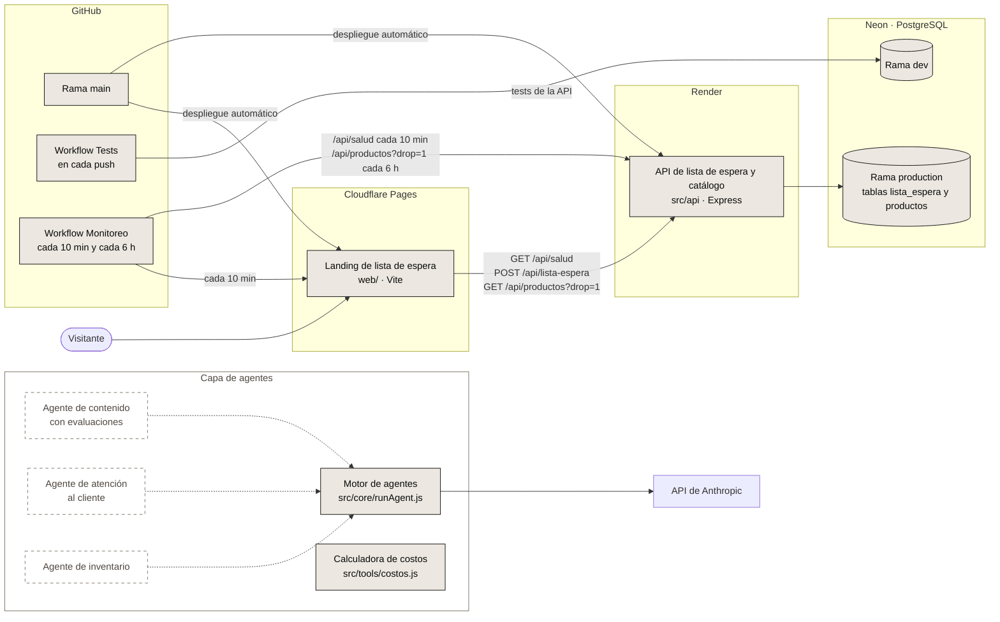

# VOW

- **Landing:** https://vow-17x.pages.dev
- **API:** `https://vow-2i0f.onrender.com` (por ejemplo, [`/api/salud`](https://vow-2i0f.onrender.com/api/salud) o [`/api/productos?drop=1`](https://vow-2i0f.onrender.com/api/productos?drop=1))

[](https://github.com/FacundoGuiraldes/vow/actions/workflows/tests.yml)
[](https://github.com/FacundoGuiraldes/vow/actions/workflows/monitoreo.yml)


VOW es una marca argentina de ropa y accesorios de gym que vende directo al público. Está en construcción, con lanzamiento previsto para 2027.

Este repositorio contiene el backend y la capa de agentes de IA de la marca. En `web/` también vive la landing de la lista de espera.

## Qué funciona hoy

- **API de lista de espera:** `POST /api/lista-espera` recibe `{ email, instagram, origen }`, valida y normaliza los datos y guarda el registro. `instagram` es opcional: se guarda sin "@", en minúsculas, y tiene que tener de 1 a 30 letras, números, puntos o guiones bajos. `GET /api/salud` responde `{ "ok": true }` sin consultar la base.
- **Catálogo del Drop 01:** tabla `productos` con los 7 productos del Drop 01 en estado concepto, cargados con el script `db-seed`. `GET /api/productos` y `GET /api/productos/:slug` los exponen sin precios, stock ni datos internos.
- **Sección Drop 01 en la landing:** muestra la imagen conceptual del drop y el listado que trae de la API, con avisos mientras el servidor despierta y si la carga falla.
- **Conexión a PostgreSQL (Neon):** pool de conexiones, script de prueba y migración de las tablas `lista_espera` y `productos`.
- **Motor de agentes:** ejecuta agentes sobre el SDK de Anthropic con soporte para herramientas, límite de turnos y conteo de tokens.
- **Calculadora de costos:** calcula el costo de importación por unidad y el margen a partir de los datos de una orden. Todavía no incluye IVA de importación ni Ingresos Brutos, que quedan pendientes de confirmar con un contador.
- **Tests y CI:** 25 tests automáticos que corren en GitHub Actions con cada push.
- **Tests e2e:** suite de Playwright en TypeScript (smoke, funcionales con la API simulada, accesibilidad con axe e integración contra la base `dev`) en cuatro navegadores.
- **Monitoreo:** un workflow programado revisa cada 10 minutos que la landing y `GET /api/salud` respondan, y cada 6 horas que el catálogo del Drop 01 devuelva productos.
- **Entorno de desarrollo:** configuración de GitHub Codespaces que instala las dependencias y levanta la API y la landing al arrancar.

## Arquitectura



Los bloques con borde continuo ya existen en el repo. Los bloques con borde punteado están planificados.

## Publicación

| Parte | Dónde corre | URL |
|---|---|---|
| Landing (`web/`) | Cloudflare Pages | https://vow-17x.pages.dev |
| API (`src/api`) | Render, plan gratuito | `https://vow-2i0f.onrender.com` (la raíz no tiene ruta; probá [`/api/salud`](https://vow-2i0f.onrender.com/api/salud)) |
| Base de datos | Neon (PostgreSQL) | No es pública |

Cloudflare Pages y Render despliegan automáticamente cada vez que se actualiza `main`, así que todo lo que se mergea a `main` sale a producción.

Por el plan gratuito, Render apaga la API tras un rato sin tráfico y el primer pedido siguiente puede tardar cerca de un minuto. Para acortar esa espera, la landing despierta la API con `GET /api/salud` al cargar, y el workflow de monitoreo le pega cada 10 minutos.

### Ramas de la base en Neon

- **`production`:** la base que usa la API publicada.
- **`dev`:** la base para desarrollo y para los tests de la API, tanto en local como en la CI.

Como el despliegue desde `main` es automático, un cambio de esquema (tabla o columna nueva) se aplica primero en `production` con `npm run db-migrar` y recién después se mergea el código que lo usa. La migración solo crea lo que falta, así que se puede correr antes del merge sin romper la versión publicada.

## Endpoints de la API

| Método y ruta | Qué hace |
|---|---|
| `GET /api/salud` | Responde `{ "ok": true }` sin consultar la base. Sirve para despertar el servidor. |
| `POST /api/lista-espera` | Anota un email en la lista de espera, con Instagram opcional. Límite: 5 pedidos por minuto por IP. |
| `GET /api/productos` | Devuelve `{ "productos": [...] }` ordenados por drop y número. Acepta `?drop=N` (entero positivo); con otro valor responde 400. |
| `GET /api/productos/:slug` | Devuelve `{ "producto": {...} }`. El slug tiene que cumplir `^[a-z0-9-]{1,60}$` (si no, 400) y, si no existe, responde 404 con "Producto no encontrado". |

Los dos endpoints de productos responden con `Cache-Control: public, max-age=300` y tienen su propio límite de 60 pedidos por minuto por IP, separado del de la lista de espera. Solo exponen campos públicos: `drop_numero`, `numero`, `slug`, `nombre`, `categoria`, `descripcion`, `colores`, `destacado`, `estado` e `imagen`.

### Tabla `productos`

| Columna | Tipo y reglas |
|---|---|
| `id` | serial, clave primaria (no se expone en la API) |
| `drop_numero` | entero, por defecto 1 |
| `numero` | entero; único junto con `drop_numero` |
| `slug` | texto único |
| `nombre`, `descripcion` | texto |
| `categoria` | `ropa` o `accesorio` |
| `colores` | lista de textos |
| `destacado` | booleano, por defecto `false` |
| `estado` | `concepto`, `proximamente` o `disponible`; por defecto `concepto` |
| `imagen` | texto opcional; por ahora `null` |

La tabla no tiene columnas de precio, stock, material, gramaje ni medidas. Los datos del Drop 01 viven en `src/data/drop-01.js` y se cargan con `npm run db-seed`, que actualiza los productos existentes por `slug` y nunca borra registros.

## Stack

| Capa | Tecnología |
|---|---|
| Runtime | Node.js 24 (ESM) |
| API | Express + `pg` |
| Base de datos | PostgreSQL (Neon) |
| Landing | Vite + JavaScript, con Lenis y GSAP |
| Agentes | SDK de Anthropic |
| Tests | `node --test` y Playwright (e2e) con axe-core |
| CI y monitoreo | GitHub Actions |
| Hosting | Cloudflare Pages (landing) y Render (API) |

## Cómo correrlo

### Requisitos

- Node.js 24 (la misma versión mayor que usa la CI) y npm.
- Una base de datos PostgreSQL accesible por URL.
- Una API key de Anthropic, solo para los scripts de agentes.

### Instalación

```bash
git clone https://github.com/FacundoGuiraldes/vow.git
cd vow
npm ci
cd web && npm ci && cd ..
```

### Variables de entorno

Copiá la plantilla y completá los valores en `.env`. El archivo `.env` está en `.gitignore` y nunca se sube al repo.

```bash
cp .env.example .env
```

| Variable | Para qué sirve |
|---|---|
| `ANTHROPIC_API_KEY` | Clave de la API de Anthropic. La usan el motor de agentes y los scripts `hola` y `prueba`. |
| `DATABASE_URL` | Cadena de conexión a PostgreSQL. La usan la API, la migración y los tests de la API. |
| `ALLOWED_ORIGINS` | Orígenes que pueden llamar a la API desde el navegador, separados por coma. Hace falta cuando la landing llama a la API en otro dominio o puerto (por ejemplo, si `VITE_API_URL` apunta a `http://localhost:3000`, tiene que incluir la dirección donde corre Vite). Si queda vacía, ningún otro sitio puede llamar a la API. |
| `VITE_API_URL` | URL base de la API que usa la landing. Si queda vacía, la landing llama a `/api/...` en su mismo dominio; en desarrollo, Vite reenvía esas rutas a la API local en el puerto 3000. |
| `TRUST_PROXY` | Se activa con `1` solo cuando la API corre detrás de un proxy. Así el límite de pedidos usa la IP real del visitante (`X-Forwarded-For`) y no la del proxy. En local se deja vacía. |

La API también acepta `PORT`, que es opcional (por defecto 3000). La landing lee el mismo `.env` de la raíz, y Vite solo expone al navegador las variables que empiezan con `VITE_`.

### Primer arranque

```bash
npm run db-probar
npm run db-migrar
npm run db-seed
npm run dev
```

`npm run dev` levanta en segundo plano la API (puerto 3000) y la landing (puerto 5173), y deja los logs en `.devcontainer/logs/`. Si alguno de los dos puertos ya está ocupado, no vuelve a levantar ese servicio. La landing queda en http://localhost:5173.

También se pueden levantar por separado, cada uno en su terminal:

```bash
npm run servidor
```

```bash
cd web
npm run dev
```

### En GitHub Codespaces

El repo incluye una configuración en `.devcontainer/`:

- Al crear el Codespace instala las dependencias de la raíz y de `web/` (`npm ci`).
- Cada vez que arranca corre `.devcontainer/iniciar.sh` (lo mismo que `npm run dev`), así que la API y la landing quedan levantadas.
- Reenvía los puertos 5173 (Landing) y 3000 (API).

El `.env` no se crea solo: hay que copiarlo de `.env.example` y completarlo, como en local; sin él, la API no se puede conectar a la base. Para abrir la landing desde el navegador, usá la pestaña **Puertos** del Codespace (puerto 5173). Vite ya acepta el dominio `*.app.github.dev` con el que Codespaces reenvía los puertos.

### Scripts

| Script | Qué hace |
|---|---|
| `npm test` | Corre todos los tests con `node --test`. |
| `npm run dev` | Levanta la API y la landing en segundo plano (`.devcontainer/iniciar.sh`). |
| `npm run test:e2e` | Corre la suite e2e de Playwright (ver [Tests e2e](#tests-e2e-playwright)). |
| `npm run servidor` | Levanta la API (lista de espera y catálogo). |
| `npm run db-probar` | Verifica la conexión a la base y muestra la versión de PostgreSQL. |
| `npm run db-migrar` | Crea las tablas `lista_espera` y `productos` si no existen y agrega las columnas nuevas a las tablas existentes. Se puede correr más de una vez. |
| `npm run db-seed` | Carga o actualiza los productos del Drop 01. Se puede correr más de una vez sin duplicar y nunca borra registros. |
| `npm run costos` | Corre la calculadora de costos con un caso de ejemplo. |
| `npm run hola` | Pide un eslogan a la API de Anthropic. Hace una llamada real y consume crédito. |
| `npm run prueba` | Corre el agente de prueba sobre el motor de agentes. Hace una llamada real y consume crédito. |

Dentro de `web/`: `npm run dev`, `npm run build` y `npm run preview`.

### Tests

```bash
npm test
```

Son 25 tests: 3 de la calculadora de costos, 13 de la lista de espera y 9 del catálogo. Los de la API necesitan `DATABASE_URL` y antes de empezar corren la migración; los del catálogo también corren el seed. Las dos operaciones se pueden repetir sin duplicar datos. Los de la lista de espera usan emails descartables bajo un dominio `.invalid` y, al terminar, borran los registros que crearon.

Los tests de la API usan la rama `dev` de Neon: tanto en local como en la CI, `DATABASE_URL` tiene que apuntar a `dev` y nunca a `production`.

### Tests e2e (Playwright)

Suite de punta a punta en [`e2e/`](e2e/), con TypeScript, Page Object Model y fixtures propias. Corre en Chromium, Firefox y WebKit de escritorio y en un perfil móvil (Pixel 7).

```bash
npx playwright install --with-deps   # la primera vez: navegadores
E2E_ALLOW_DB_WRITES=dev npm run test:e2e
```

En local, Playwright levanta la API (puerto 3000) y la landing compilada (`vite preview`, puerto 4173), o reutiliza las que ya estén corriendo.

| Tag | Qué cubre | Contra qué |
|---|---|---|
| `@smoke` | La landing carga con el hero, se ven las secciones principales, el catálogo muestra los productos de la API y `/api/salud` responde. Solo lectura. | Local o producción |
| `@funcional` | Formulario (éxito, email inválido, errores 400/429/500, carga y doble envío), anclas e índice, política de privacidad, catálogo con error o con HTML malicioso, responsive de 360 a 1920 px y `prefers-reduced-motion`. La API está simulada con `page.route`. | Local |
| `@a11y` | Análisis WCAG 2.1 AA con axe y uso del formulario solo con el teclado. | Local, Chromium |
| `@integracion` | Alta real en la lista de espera y catálogo real, contra la API local y la base `dev`. | Local, Chromium |

Otros scripts: `npm run test:e2e:smoke`, `npm run test:e2e:ui` (modo interactivo), `npm run test:e2e:report` (abre el último reporte HTML; en Codespaces, desde la pestaña Puertos) y `npm run test:e2e:tipos` (chequeo de tipos).

**Smoke contra producción (solo lectura):**

```bash
E2E_BASE_URL=https://vow-17x.pages.dev E2E_API_URL=https://vow-2i0f.onrender.com npm run test:e2e:smoke
```

**Ningún test escribe en producción:**

- Si `E2E_BASE_URL` no es local, la configuración solo corre los `@smoke` y no levanta servidores.
- Todos los tests cortan cualquier pedido que no sea de lectura hacia una API que no sea local, y en ese caso fallan.
- La integración solo corre con API local, con `E2E_ALLOW_DB_WRITES=dev` y, si está definida `E2E_PROD_DB_HOST`, solo si `DATABASE_URL` no apunta a ese host. Sin `E2E_ALLOW_DB_WRITES` se saltea.
- Los emails de prueba son `e2e-<corrida>-<aleatorio>@vow-pruebas.invalid`. Cada test borra exactamente los que creó, y un barrido final borra los de corridas viejas que se hayan cortado (más de 2 horas), sin tocar los de una corrida en curso.

| Variable | Para qué sirve |
|---|---|
| `E2E_BASE_URL` | Dónde está la landing. Por defecto, `http://localhost:4173`. |
| `E2E_API_URL` | URL base de la API. Solo hace falta contra un sitio publicado. |
| `E2E_ALLOW_DB_WRITES` | Tiene que valer `dev` para que corran los tests de integración. |
| `E2E_PROD_DB_HOST` | Opcional. Solo el nombre del host de la rama `production` de Neon (por ejemplo, `ep-xxxx.sa-east-1.aws.neon.tech`), nunca la URL completa ni credenciales. Con o sin `-pooler` da igual. |

Para cargar `E2E_PROD_DB_HOST` en GitHub: **Settings > Secrets and variables > Actions > pestaña Variables > New repository variable**, con el nombre `E2E_PROD_DB_HOST` y el host como valor. Es una variable y no un secreto porque no contiene credenciales. Si no está definida, las otras dos condiciones siguen protegiendo.

## CI y monitoreo

| Workflow | Cuándo corre | Qué hace |
|---|---|---|
| [`tests.yml`](.github/workflows/tests.yml) | Con cada push, en cualquier rama | Instala dependencias con Node 24 y corre `npm test`. Toma `DATABASE_URL` (rama `dev`) de un secreto del repositorio. |
| [`e2e.yml`](.github/workflows/e2e.yml) | En cada pull request (Chromium); los lunes y a mano, con los cuatro navegadores | Chequea los tipos de `e2e/` y corre la suite de Playwright contra la API local y la base `dev`. Guarda los navegadores en caché y, si algo falla, sube el reporte HTML y las trazas como artefactos. |
| [`monitoreo.yml`](.github/workflows/monitoreo.yml) | Cada 10 minutos y cada 6 horas (y a mano desde la pestaña Actions) | Cada 10 minutos revisa que la landing cargue y que `GET /api/salud` responda `{ "ok": true }`; de paso, mantiene despierta la API en Render sin tocar la base. Cada 6 horas revisa que `GET /api/productos?drop=1` devuelva al menos un producto. |

El monitoreo necesita el secreto `API_URL` con la URL base de la API; si falta, falla con un aviso que lo indica. GitHub solo ejecuta los workflows programados desde la rama por defecto (`main`).

## Decisiones de diseño

- **Consultas parametrizadas:** todo el SQL usa parámetros (`$1`, `$2`) y nunca concatena texto, para evitar inyección SQL.
- **Respuesta idéntica para emails repetidos:** un email nuevo y uno ya anotado reciben el mismo `200` y el mismo mensaje, así nadie puede averiguar quién está en la lista.
- **Límite de pedidos por IP:** 5 pedidos por minuto en el endpoint de la lista de espera. `GET /api/salud` no cuenta para el límite.
- **CORS restringido:** solo responden a los orígenes definidos en `ALLOWED_ORIGINS`.
- **Catálogo sin datos internos:** la API elige explícitamente las columnas públicas, así que el `id` y cualquier dato comercial quedan afuera. La landing dibuja el catálogo solo con `textContent`, nunca con `innerHTML`.
- **Datos descartables en los tests:** los tests usan emails que no pueden existir y los borran al terminar, sin tocar registros reales.

## Hoja de ruta

- [x] Publicar la API y la landing.
- [x] Catálogo del Drop 01 en la API y en la landing.
- [ ] Agente de contenido con evaluaciones.
- [ ] Agente de atención al cliente.
- [ ] Agente de inventario.
