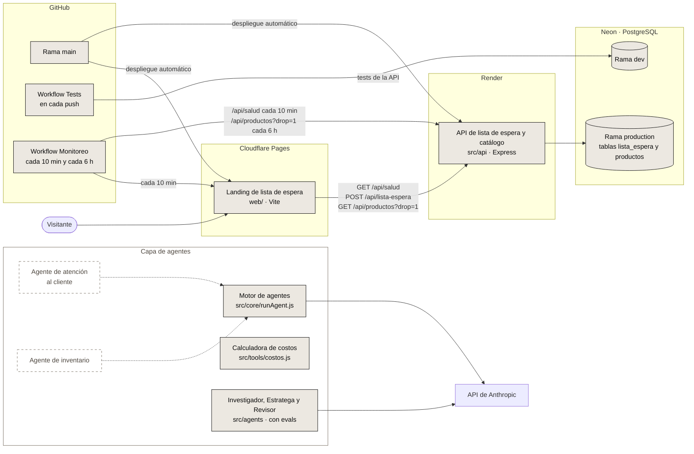
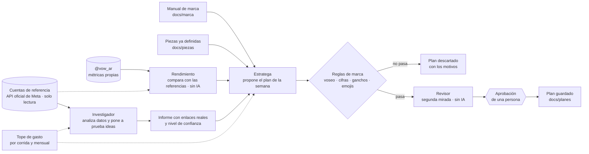

# VOW

- **Landing:** https://vow-17x.pages.dev
- **API:** `https://vow-2i0f.onrender.com` (por ejemplo, [`/api/salud`](https://vow-2i0f.onrender.com/api/salud) o [`/api/productos?drop=1`](https://vow-2i0f.onrender.com/api/productos?drop=1))

[](https://github.com/FacundoGuiraldes/vow/actions/workflows/tests.yml)
[](https://github.com/FacundoGuiraldes/vow/actions/workflows/monitoreo.yml)


VOW es una marca argentina de ropa y accesorios de gym que vende directo al público. Está en construcción, con lanzamiento previsto para 2027.

Este repositorio es la base técnica de la marca:

- **Landing y API** (`web/`, `src/api`): lista de espera y catálogo del Drop 01, publicados y monitoreados.
- **Un sistema de agentes de IA** que investiga cuentas de referencia y propone el plan de contenido semanal, siempre con reglas de marca, tope de gasto y aprobación de una persona antes de seguir. [Ver cómo funciona](#el-sistema-de-agentes).
- **Piezas de Instagram hechas con código**: láminas de carruseles y reels que se generan desde el repo, con el mismo sistema visual de la marca.

## Qué demuestra este proyecto

La parte difícil de usar IA en serio no es llamarla, es **poder confiar en lo que devuelve**. Por eso la mayor parte del trabajo está en controlarla y medirla:

- **Reglas que se pueden probar:** la marca tiene un manual (`docs/marca/cerebro-de-marca.md`) y sus reglas están en código, no solo en un prompt. Frenan datos inventados, frases fuera de tono y ganchos repetidos.
- **Evals con un número:** hay casos fijos que corren gratis en cada cambio y una corrida con la IA real que mide qué porcentaje de planes cumple las reglas y cuánto cuesta cada uno.
- **Tests que prueban a los tests:** cada cambio pasa por mutation testing (se rompe el código a propósito y se comprueba que algún test lo detecte).
- **Control del gasto:** tope por corrida, tope mensual y modo simulado que prueba todo el flujo sin gastar.
- **La IA propone, una persona decide:** ningún agente publica nada.

## Qué funciona hoy

- **API de lista de espera:** `POST /api/lista-espera` recibe `{ email, instagram, origen }`, valida y normaliza los datos y guarda el registro. `instagram` es opcional: se guarda sin "@", en minúsculas, y tiene que tener de 1 a 30 letras, números, puntos o guiones bajos. `GET /api/salud` responde `{ "ok": true }` sin consultar la base.
- **Catálogo del Drop 01:** tabla `productos` con los 7 productos del Drop 01 en estado concepto, cargados con el script `db-seed`. `GET /api/productos` y `GET /api/productos/:slug` los exponen sin precios, stock ni datos internos.
- **Sección Drop 01 en la landing:** muestra la imagen conceptual del drop y el listado que trae de la API, con avisos mientras el servidor despierta y si la carga falla.
- **Conexión a PostgreSQL (Neon):** pool de conexiones, script de prueba y migración de las tablas `lista_espera` y `productos`.
- **Rendimiento propio:** `npm run rendimiento` mide las publicaciones de @vow_ar (alcance, guardados, compartidos) y las compara con las cuentas de referencia, sin IA. El Estratega lee el último informe.
- **Sistema de agentes:** Investigador, Estratega y Revisor, coordinados por un orquestador que frena donde hace falta una persona. Detalle en [El sistema de agentes](#el-sistema-de-agentes).
- **Reglas de marca en código:** voseo, palabras y frases prohibidas, máximo de emojis, y toda cifra tiene que existir en los datos cargados.
- **Evals offline y online:** 121 casos gratis en el CI y una corrida con la IA real contra una línea base. Detalle en [Cómo sé que funciona](#cómo-sé-que-funciona).
- **Tope de gasto:** por corrida y mensual (`TOPE_MENSUAL_USD`), con `npm run gasto` para ver cuánto va del mes.
- **Piezas de Instagram por código:** láminas de carruseles (`npm run laminas`) y reels animados (`npm run reel:logo`) generados con Playwright y ffmpeg, más la foto de perfil. Las piezas definidas viven en `docs/piezas/`.
- **Motor de agentes base:** `src/core/runAgent.js` ejecuta agentes sobre el SDK de Anthropic con herramientas, límite de turnos y conteo de tokens.
- **Calculadora de costos:** calcula el costo de importación por unidad y el margen a partir de los datos de una orden. Todavía no incluye IVA de importación ni Ingresos Brutos, que quedan pendientes de confirmar con un contador.
- **Tests y CI:** más de 240 tests automáticos (`node --test`) que corren en GitHub Actions con cada push. Los que necesitan base de datos se saltean si no hay `DATABASE_URL`, pero en el CI fallan si falta.
- **Tests e2e:** suite de Playwright en TypeScript (smoke, funcionales con la API simulada, accesibilidad con axe e integración contra la base `dev`) en cuatro navegadores.
- **Monitoreo:** un workflow programado revisa cada 10 minutos que la landing y `GET /api/salud` respondan, y cada 6 horas que el catálogo del Drop 01 devuelva productos.
- **Entorno de desarrollo:** configuración de GitHub Codespaces que instala las dependencias y levanta la API y la landing al arrancar.

## Arquitectura



Los bloques con borde continuo ya existen en el repo. Los bloques con borde punteado están planificados.

## El sistema de agentes

Hoy cubre una tarea concreta: **decidir qué publicar cada semana en @vow_ar**, apoyándose en datos reales y en el manual de marca.



| Pieza | Qué hace | Qué no hace |
|---|---|---|
| **Investigador** (`src/agents/investigador.js`) | Lee datos públicos de cuentas de referencia, calcula el rendimiento con la mediana y mide cada publicación contra el tamaño de su cuenta. Pone a prueba hipótesis de formato. | Afirmar algo que los datos no sostienen: cada conclusión cita publicaciones reales y dice qué tan segura es. No cambia al Estratega por su cuenta. |
| **Rendimiento** (`src/agents/rendimiento.js`) | Mide las publicaciones de @vow_ar con sus métricas privadas (alcance, guardados, compartidos, interacciones sobre alcance) y las compara por tipo con la mediana de las cuentas de referencia. Avisa cuando la muestra es chica, cuando una publicación es reciente o cuando los seguidores pueden no ser reales. No usa IA ni gasta. | Sacar conclusiones con pocas publicaciones: con menos de 3 de un tipo, marca "muestra muy chica". |
| **Estratega** (`src/agents/estratega.js`) | Propone las piezas de una semana (gancho, guion, epígrafe, llamado a la acción, justificación), sin repetir lo que ya está definido. | Publicar. Propone y nada más. |
| **Revisor** (`src/agents/revisor.js`) | Vuelve a pasar un plan por las mismas reglas con el contexto de hoy: un plan editado a mano, uno viejo o una pieza definida después. No usa IA ni gasta. | Aprobar solo: la aprobación es de una persona. |
| **Orquestador** (`src/orquestador`) | Ejecuta los pasos en orden, guarda lo que hizo cada uno (`docs/ejecuciones/`), cuenta el gasto y no repite un paso que ya terminó. Un paso que falla frena el flujo. | Saber nada de Instagram ni de Claude: solo ordena pasos. |

Cómo se usa:

```bash
npm run rendimiento                                   # mide @vow_ar contra las referencias (sin IA, conviene antes de planificar)
npm run semana -- --semana 2026-11-02 --simulado      # prueba todo el flujo sin gastar
npm run semana -- --semana 2026-11-02                 # con la IA real: planifica y revisa, y se frena en la aprobación
npm run semana -- --semana 2026-11-02 --aprobar aprobar-plan   # aprueba; al volver a correr se guarda el plan
```

Qué cuida el sistema para que la IA no se descontrole:

- **Nada de datos inventados:** toda cifra de un texto tiene que existir en los datos cargados. Hoy solo existen "01" (de Drop 01) y "2027". Las medidas de armado de una pieza ("carrusel de 6 láminas") se permiten solo en el guion.
- **Tono de marca verificable:** las reglas de `src/agents/reglas-marca.js` detectan voseo mal usado, motivación vacía, exceso de emojis y ganchos copiados de otras cuentas.
- **Los errores dicen dónde están:** un rechazo por una cifra muestra la frase donde aparece, para decidir si fue un error real o una regla demasiado estricta.
- **Gasto acotado:** `--tope-usd` por corrida y un tope mensual que corta antes de llamar a la API (se configura con `TOPE_MENSUAL_USD`, por defecto US$ 5). Con `--simulado` ningún comando gasta.
- **Todo a mano:** los workflows que usan la IA solo se lanzan manualmente desde Actions.

### Conector de Instagram (MCP)

Un servidor [MCP](https://modelcontextprotocol.io) en `src/mcp/instagram/` conecta Claude Code con la cuenta de @vow_ar por la API oficial de Meta. Está registrado en [`.mcp.json`](.mcp.json): al abrir Claude Code en el repo, aparece como `vow-instagram` (la primera vez pide aprobarlo).

| Herramienta | Qué hace |
|---|---|
| `perfil`, `publicaciones` | Datos de la cuenta y últimas publicaciones con likes y comentarios. |
| `metricas_publicacion` | Alcance, vistas, guardados, compartidos e interacciones de una publicación. |
| `comentarios` | Comentarios de una publicación. |
| `preparar_publicacion` | Valida el texto, chequea el cupo diario de Meta y crea el contenedor de una imagen, un reel o un carrusel. **No publica.** |
| `publicar` | Publica un contenedor ya preparado. Exige `confirmar: true`. |
| `responder_comentario` | Responde un comentario. Exige `confirmar: true`. |

Qué cuida:

- **Solo lectura por defecto:** publicar y responder están apagados salvo `INSTAGRAM_PERMITIR_PUBLICAR=1`. Además, Claude Code pide permiso antes de cada herramienta.
- **Publicar lleva dos pasos:** preparar (se puede revisar) y publicar con confirmación, solo si Meta terminó de procesar el archivo.
- **Las mismas reglas de marca que el Estratega:** un epígrafe o una respuesta con urgencia falsa, sin voseo o con una cifra inventada se rechaza antes de llamar a Meta.
- **El token nunca aparece** en respuestas ni en errores, y en los pedidos de escritura viaja en el cuerpo, no en la dirección.
- **Archivos por dirección pública:** Meta descarga las imágenes (solo JPEG) y los videos desde una dirección `https` pública; no acepta archivos locales.

Para usarlo, la app de Meta necesita los permisos `instagram_basic`, `pages_show_list`, `pages_read_engagement` e `instagram_manage_insights` para leer, y además `instagram_content_publish` e `instagram_manage_comments` para publicar y responder. Se prueba con `node --test` y un Meta simulado: los tests no tocan la cuenta real.

## Cómo sé que funciona

Un sistema con IA no se prueba mirando una vez la salida. Hay tres capas:

1. **Tests** (`npm test`): más de 240 tests de reglas, agentes, orquestador, API y diseño, con la IA reemplazada por un cliente simulado.
2. **Evals offline** (`npm run evals`, gratis, en el CI): 121 casos fijos. Incluyen los falsos positivos reales que ya se corrigieron, para que no vuelvan, y una frase por cada palabra de cada regla de marca. Si una regla no tiene ningún caso que la dispare, el test falla.
3. **Evals online** (`npm run evals:online`, con la IA real): pide al Estratega seis pedidos distintos (con y sin producto, con y sin gente, distintas fases), mide el porcentaje que cumple las reglas, el costo por plan y qué reglas rechazan más, y lo compara con una línea base guardada. Última línea base: **6 de 6 aprobados, unos US$ 0,08 por plan.**

Además, cada cambio pasa por **mutation testing**: se rompe el código de a una cosa y se comprueba que algún test falle. Los que no fallan se corrigen o se documentan como equivalentes.

Un ejemplo de cómo se ve en la práctica: una corrida online rechazó planes por la cifra "6". Con los errores que muestran la frase se vio que era "carrusel de 6 láminas", una medida de armado y no un dato inventado. La regla estaba siendo demasiado estricta; se corrigió solo para el guion, con tests que prueban que "3 días" o "5 straps" siguen siendo rechazados, y una nueva corrida dio 6 de 6. Los detalles de las evals están en [`evals/README.md`](evals/README.md).

## Publicación

| Parte | Dónde corre | URL |
|---|---|---|
| Landing (`web/`) | Cloudflare Pages | https://vow-17x.pages.dev |
| API (`src/api`) | Render, plan gratuito | `https://vow-2i0f.onrender.com` (la raíz no tiene ruta; probá [`/api/salud`](https://vow-2i0f.onrender.com/api/salud)) |
| Base de datos | Neon (PostgreSQL) | No es pública |

Cloudflare Pages y Render despliegan automáticamente cada vez que se actualiza `main`, así que todo lo que se mergea a `main` sale a producción.

Por el plan gratuito, Render apaga la API tras un rato sin tráfico y el primer pedido siguiente puede tardar cerca de un minuto. Para acortar esa espera, la landing despierta la API con `GET /api/salud` al cargar, y el workflow de monitoreo le pega cada 10 minutos.

### Ramas de la base en Neon

- **`production`:** la base que usa la API publicada.
- **`dev`:** la base para desarrollo y para los tests de la API, tanto en local como en la CI.

Como el despliegue desde `main` es automático, un cambio de esquema (tabla o columna nueva) se aplica primero en `production` con `npm run db-migrar` y recién después se mergea el código que lo usa. La migración solo crea lo que falta, así que se puede correr antes del merge sin romper la versión publicada.

## Endpoints de la API

| Método y ruta | Qué hace |
|---|---|
| `GET /api/salud` | Responde `{ "ok": true }` sin consultar la base. Sirve para despertar el servidor. |
| `POST /api/lista-espera` | Anota un email en la lista de espera, con Instagram opcional. Límite: 5 pedidos por minuto por IP. |
| `GET /api/productos` | Devuelve `{ "productos": [...] }` ordenados por drop y número. Acepta `?drop=N` (entero positivo); con otro valor responde 400. |
| `GET /api/productos/:slug` | Devuelve `{ "producto": {...} }`. El slug tiene que cumplir `^[a-z0-9-]{1,60}$` (si no, 400) y, si no existe, responde 404 con "Producto no encontrado". |

Los dos endpoints de productos responden con `Cache-Control: public, max-age=300` y tienen su propio límite de 60 pedidos por minuto por IP, separado del de la lista de espera. Solo exponen campos públicos: `drop_numero`, `numero`, `slug`, `nombre`, `categoria`, `descripcion`, `colores`, `destacado`, `estado` e `imagen`.

### Tabla `productos`

| Columna | Tipo y reglas |
|---|---|
| `id` | serial, clave primaria (no se expone en la API) |
| `drop_numero` | entero, por defecto 1 |
| `numero` | entero; único junto con `drop_numero` |
| `slug` | texto único |
| `nombre`, `descripcion` | texto |
| `categoria` | `ropa` o `accesorio` |
| `colores` | lista de textos |
| `destacado` | booleano, por defecto `false` |
| `estado` | `concepto`, `proximamente` o `disponible`; por defecto `concepto` |
| `imagen` | texto opcional; por ahora `null` |

La tabla no tiene columnas de precio, stock, material, gramaje ni medidas. Los datos del Drop 01 viven en `src/data/drop-01.js` y se cargan con `npm run db-seed`, que actualiza los productos existentes por `slug` y nunca borra registros.

## Publicación programada de Instagram (Telegram)

Flujo: el **lunes** el Estratega arma el plan de la semana y te llega por Telegram (una tarjeta por pieza, con qué filmar y cuándo te lo recuerdan). Podés **responder a cualquier tarjeta** para cambiarla, o escribir sin responder para pasarle una novedad de VOW al próximo plan. Todos los días a las **8:00** (Argentina) llega lo de hoy con la hora de publicación. Dos horas antes, si todavía no confirmaste, te llega un recordatorio. Si confirmás **ese mismo día**, el sistema publica a la hora; si no confirmás, **no se publica nada**.

- Recordatorio de filmación: 3 días antes de la fecha de la pieza (si el plan llega con menos margen, sale marcado como urgente).
- Seguridad: la confirmación vale solo el día en que se da; cualquier edición la borra; una publicación nunca se reintenta sola; si el sistema llega más de 20 minutos tarde, pregunta; `/pausar` y `/reanudar` frenan todo; sin `INSTAGRAM_PERMITIR_PUBLICAR=1` corre en simulación.
- Límites: las stories se avisan pero se publican a mano; no hay música de la biblioteca vía API; Telegram solo deja bajar archivos de hasta 20 MB.
- Imágenes con IA (opcional): con `GEMINI_API_KEY` (plan gratis de Google AI Studio), las piezas de tipo imagen muestran el botón 🎨 *Generar con IA*; también sirve `/ia <descripción>` respondiendo a la pieza. La imagen llega por Telegram para que la veas, con *Usar esta*, *Otra* o *Cambiar indicación*. El recorte 4:5 y el isotipo de VOW los pone el código (la IA no dibuja textos ni logos). Tope: 3 intentos por pieza y 10 por día. Los reels y carruseles siguen con tus archivos.
- Piezas: `src/programacion/`. Plan semanal: `npm run plan:lunes` (workflow `plan-lunes.yml`). Ticker: cron-job.org cada minuto + `tick.yml` de respaldo.

Puesta en marcha:
1. Crear el bot con @BotFather, mandarle `/start` para ver tu chat id.
2. Variables en Render: `TELEGRAM_TOKEN`, `TELEGRAM_CHAT_ID`, `TELEGRAM_WEBHOOK_SECRETO`, `PROGRAMACION_SECRETO`, `URL_PUBLICA`, `ANTHROPIC_API_KEY`, `INSTAGRAM_TOKEN`, `INSTAGRAM_USER_ID` (sin `INSTAGRAM_PERMITIR_PUBLICAR` al principio: simulación).
3. Secrets en GitHub Actions: `ANTHROPIC_API_KEY`, `INSTAGRAM_TOKEN`, `INSTAGRAM_USER_ID`, `URL_PUBLICA`, `PROGRAMACION_SECRETO`.
4. `npm run db-migrar` y `npm run telegram:webhook`.
5. cron-job.org: POST cada minuto a `URL_PUBLICA/api/programacion/tick` con `Authorization: Bearer <PROGRAMACION_SECRETO>` (también mantiene despierto a Render free).
6. Tras un par de semanas de simulación, activar `INSTAGRAM_PERMITIR_PUBLICAR=1`. El token de Meta vence cada 60 días.

## Stack

| Capa | Tecnología |
|---|---|
| Runtime | Node.js 24 (ESM) |
| API | Express + `pg` |
| Base de datos | PostgreSQL (Neon) |
| Landing | Vite + JavaScript, con Lenis y GSAP |
| Agentes | SDK de Anthropic, con un cliente simulado para tests y modo `--simulado` |
| Piezas de Instagram | Playwright (render de cuadros) y ffmpeg (video) |
| Tests | `node --test` y Playwright (e2e) con axe-core |
| CI y monitoreo | GitHub Actions |
| Hosting | Cloudflare Pages (landing) y Render (API) |

## Cómo correrlo

### Requisitos

- Node.js 24 (la misma versión mayor que usa la CI) y npm.
- Una base de datos PostgreSQL accesible por URL.
- Una API key de Anthropic, solo para los scripts de agentes.

### Instalación

```bash
git clone https://github.com/FacundoGuiraldes/vow.git
cd vow
npm ci
cd web && npm ci && cd ..
```

### Variables de entorno

Copiá la plantilla y completá los valores en `.env`. El archivo `.env` está en `.gitignore` y nunca se sube al repo.

```bash
cp .env.example .env
```

| Variable | Para qué sirve |
|---|---|
| `ANTHROPIC_API_KEY` | Clave de la API de Anthropic. La usan el motor de agentes y los scripts `hola` y `prueba`. |
| `DATABASE_URL` | Cadena de conexión a PostgreSQL. La usan la API, la migración y los tests de la API. |
| `TOPE_MENSUAL_USD` | Tope de gasto mensual en dólares para los comandos que usan la IA. Opcional; por defecto 5. |
| `INSTAGRAM_TOKEN` y `INSTAGRAM_USER_ID` | Acceso a la API oficial de Meta: el Investigador baja datos públicos de las cuentas de referencia y el conector MCP gestiona @vow_ar. |
| `INSTAGRAM_PERMITIR_PUBLICAR` | Con `1`, el conector MCP puede publicar y responder comentarios. Vacía, solo lee. |
| `ALLOWED_ORIGINS` | Orígenes que pueden llamar a la API desde el navegador, separados por coma. Hace falta cuando la landing llama a la API en otro dominio o puerto (por ejemplo, si `VITE_API_URL` apunta a `http://localhost:3000`, tiene que incluir la dirección donde corre Vite). Si queda vacía, ningún otro sitio puede llamar a la API. |
| `VITE_API_URL` | URL base de la API que usa la landing. Si queda vacía, la landing llama a `/api/...` en su mismo dominio; en desarrollo, Vite reenvía esas rutas a la API local en el puerto 3000. |
| `TRUST_PROXY` | Se activa con `1` solo cuando la API corre detrás de un proxy. Así el límite de pedidos usa la IP real del visitante (`X-Forwarded-For`) y no la del proxy. En local se deja vacía. |

La API también acepta `PORT`, que es opcional (por defecto 3000). La landing lee el mismo `.env` de la raíz, y Vite solo expone al navegador las variables que empiezan con `VITE_`.

### Primer arranque

```bash
npm run db-probar
npm run db-migrar
npm run db-seed
npm run dev
```

`npm run dev` levanta en segundo plano la API (puerto 3000) y la landing (puerto 5173), y deja los logs en `.devcontainer/logs/`. Si alguno de los dos puertos ya está ocupado, no vuelve a levantar ese servicio. La landing queda en http://localhost:5173.

También se pueden levantar por separado, cada uno en su terminal:

```bash
npm run servidor
```

```bash
cd web
npm run dev
```

### En GitHub Codespaces

El repo incluye una configuración en `.devcontainer/`:

- Al crear el Codespace instala las dependencias de la raíz y de `web/` (`npm ci`).
- Cada vez que arranca corre `.devcontainer/iniciar.sh` (lo mismo que `npm run dev`), así que la API y la landing quedan levantadas.
- Reenvía los puertos 5173 (Landing) y 3000 (API).

El `.env` no se crea solo: hay que copiarlo de `.env.example` y completarlo, como en local; sin él, la API no se puede conectar a la base. Para abrir la landing desde el navegador, usá la pestaña **Puertos** del Codespace (puerto 5173). Vite ya acepta el dominio `*.app.github.dev` con el que Codespaces reenvía los puertos.

### Scripts

| Script | Qué hace |
|---|---|
| `npm test` | Corre todos los tests con `node --test`. |
| `npm run dev` | Levanta la API y la landing en segundo plano (`.devcontainer/iniciar.sh`). |
| `npm run test:e2e` | Corre la suite e2e de Playwright (ver [Tests e2e](#tests-e2e-playwright)). |
| `npm run servidor` | Levanta la API (lista de espera y catálogo). |
| `npm run db-probar` | Verifica la conexión a la base y muestra la versión de PostgreSQL. |
| `npm run db-migrar` | Crea las tablas `lista_espera` y `productos` si no existen y agrega las columnas nuevas a las tablas existentes. Se puede correr más de una vez. |
| `npm run db-seed` | Carga o actualiza los productos del Drop 01. Se puede correr más de una vez sin duplicar y nunca borra registros. |
| `npm run costos` | Corre la calculadora de costos con un caso de ejemplo. |
| `npm run evals` | Corre las 121 evals offline (gratis). |
| `npm run evals:online` | Corre las evals con la IA real contra la línea base. **Gasta**; tiene `--tope-usd`, `--solo`, `--repeticiones` y `--simulado`. |
| `npm run semana -- --semana AAAA-MM-DD` | Corre el flujo semanal: planificar, revisar y esperar tu aprobación. Con `--simulado` no gasta. |
| `npm run plan -- --semana AAAA-MM-DD` | Pide solo el plan al Estratega (sin orquestador). |
| `npm run investigar` y `npm run analizar` | Bajan datos de las cuentas de referencia y los analizan con la IA (`analizar` gasta). |
| `npm run gasto` | Muestra cuánto se gastó este mes contra el tope. |
| `npm run mcp:instagram` | Levanta el servidor MCP de Instagram a mano (normalmente lo levanta Claude Code desde `.mcp.json`). |
| `npm run laminas`, `npm run reel`, `npm run reel:logo`, `npm run foto-perfil` | Generan las láminas de los carruseles, los reels y la foto de perfil de Instagram. |
| `npm run hola` | Pide un eslogan a la API de Anthropic. Hace una llamada real y consume crédito. |
| `npm run prueba` | Corre el agente de prueba sobre el motor de agentes. Hace una llamada real y consume crédito. |

Dentro de `web/`: `npm run dev`, `npm run build` y `npm run preview`.

### Tests

```bash
npm test
```

Son más de 240 tests: calculadora de costos, lista de espera, catálogo, reglas de marca, agentes, orquestador, tope de gasto y piezas de diseño. Los de la API necesitan `DATABASE_URL` (si falta se saltean en local y fallan en el CI) y antes de empezar corren la migración; los del catálogo también corren el seed. Las dos operaciones se pueden repetir sin duplicar datos. Los de la lista de espera usan emails descartables bajo un dominio `.invalid` y, al terminar, borran los registros que crearon.

Los tests de la API usan la rama `dev` de Neon: tanto en local como en la CI, `DATABASE_URL` tiene que apuntar a `dev` y nunca a `production`.

### Tests e2e (Playwright)

Suite de punta a punta en [`e2e/`](e2e/), con TypeScript, Page Object Model y fixtures propias. Corre en Chromium, Firefox y WebKit de escritorio y en un perfil móvil (Pixel 7).

```bash
npx playwright install --with-deps   # la primera vez: navegadores
E2E_ALLOW_DB_WRITES=dev npm run test:e2e
```

En local, Playwright levanta la API (puerto 3000) y la landing compilada (`vite preview`, puerto 4173), o reutiliza las que ya estén corriendo.

| Tag | Qué cubre | Contra qué |
|---|---|---|
| `@smoke` | La landing carga con el hero, se ven las secciones principales, el catálogo muestra los productos de la API y `/api/salud` responde. Solo lectura. | Local o producción |
| `@funcional` | Formulario (éxito, email inválido, errores 400/429/500, carga y doble envío), anclas e índice, política de privacidad, catálogo con error o con HTML malicioso, responsive de 360 a 1920 px y `prefers-reduced-motion`. La API está simulada con `page.route`. | Local |
| `@a11y` | Análisis WCAG 2.1 AA con axe y uso del formulario solo con el teclado. | Local, Chromium |
| `@integracion` | Alta real en la lista de espera y catálogo real, contra la API local y la base `dev`. | Local, Chromium |

Otros scripts: `npm run test:e2e:smoke`, `npm run test:e2e:ui` (modo interactivo), `npm run test:e2e:report` (abre el último reporte HTML; en Codespaces, desde la pestaña Puertos) y `npm run test:e2e:tipos` (chequeo de tipos).

**Smoke contra producción (solo lectura):**

```bash
E2E_BASE_URL=https://vow-17x.pages.dev E2E_API_URL=https://vow-2i0f.onrender.com npm run test:e2e:smoke
```

**Ningún test escribe en producción:**

- Si `E2E_BASE_URL` no es local, la configuración solo corre los `@smoke` y no levanta servidores.
- Todos los tests cortan cualquier pedido que no sea de lectura hacia una API que no sea local, y en ese caso fallan.
- La integración solo corre con API local, con `E2E_ALLOW_DB_WRITES=dev` y, si está definida `E2E_PROD_DB_HOST`, solo si `DATABASE_URL` no apunta a ese host. Sin `E2E_ALLOW_DB_WRITES` se saltea.
- Los emails de prueba son `e2e-<corrida>-<aleatorio>@vow-pruebas.invalid`. Cada test borra exactamente los que creó, y un barrido final borra los de corridas viejas que se hayan cortado (más de 2 horas), sin tocar los de una corrida en curso.

| Variable | Para qué sirve |
|---|---|
| `E2E_BASE_URL` | Dónde está la landing. Por defecto, `http://localhost:4173`. |
| `E2E_API_URL` | URL base de la API. Solo hace falta contra un sitio publicado. |
| `E2E_ALLOW_DB_WRITES` | Tiene que valer `dev` para que corran los tests de integración. |
| `E2E_PROD_DB_HOST` | Opcional. Solo el nombre del host de la rama `production` de Neon (por ejemplo, `ep-xxxx.sa-east-1.aws.neon.tech`), nunca la URL completa ni credenciales. Con o sin `-pooler` da igual. |

Para cargar `E2E_PROD_DB_HOST` en GitHub: **Settings > Secrets and variables > Actions > pestaña Variables > New repository variable**, con el nombre `E2E_PROD_DB_HOST` y el host como valor. Es una variable y no un secreto porque no contiene credenciales. Si no está definida, las otras dos condiciones siguen protegiendo.

## CI y monitoreo

| Workflow | Cuándo corre | Qué hace |
|---|---|---|
| [`tests.yml`](.github/workflows/tests.yml) | Con cada push, en cualquier rama | Instala dependencias con Node 24 y corre `npm test`. Toma `DATABASE_URL` (rama `dev`) de un secreto del repositorio. |
| [`e2e.yml`](.github/workflows/e2e.yml) | En cada pull request (Chromium); los lunes y a mano, con los cuatro navegadores | Chequea los tipos de `e2e/` y corre la suite de Playwright contra la API local y la base `dev`. Guarda los navegadores en caché y, si algo falla, sube el reporte HTML y las trazas como artefactos. |
| [`monitoreo.yml`](.github/workflows/monitoreo.yml) | Cada 10 minutos y cada 6 horas (y a mano desde la pestaña Actions) | Cada 10 minutos revisa que la landing cargue y que `GET /api/salud` responda `{ "ok": true }`; de paso, mantiene despierta la API en Render sin tocar la base. Cada 6 horas revisa que `GET /api/productos?drop=1` devuelva al menos un producto. |

| [`evals-online.yml`](.github/workflows/evals-online.yml), [`plan-semanal.yml`](.github/workflows/plan-semanal.yml), [`investigar.yml`](.github/workflows/investigar.yml) | Solo a mano desde la pestaña Actions, y solo desde `main` | Corren las evals online, el plan semanal y la investigación de cuentas con la IA real. Gastan, por eso nunca corren solos. El resultado queda en el resumen de la corrida y como archivo descargable. |

El monitoreo necesita el secreto `API_URL` con la URL base de la API; si falta, falla con un aviso que lo indica. GitHub solo ejecuta los workflows programados desde la rama por defecto (`main`).

## Decisiones de diseño

- **Consultas parametrizadas:** todo el SQL usa parámetros (`$1`, `$2`) y nunca concatena texto, para evitar inyección SQL.
- **Respuesta idéntica para emails repetidos:** un email nuevo y uno ya anotado reciben el mismo `200` y el mismo mensaje, así nadie puede averiguar quién está en la lista.
- **Límite de pedidos por IP:** 5 pedidos por minuto en el endpoint de la lista de espera. `GET /api/salud` no cuenta para el límite.
- **CORS restringido:** solo responden a los orígenes definidos en `ALLOWED_ORIGINS`.
- **Catálogo sin datos internos:** la API elige explícitamente las columnas públicas, así que el `id` y cualquier dato comercial quedan afuera. La landing dibuja el catálogo solo con `textContent`, nunca con `innerHTML`.
- **Datos descartables en los tests:** los tests usan emails que no pueden existir y los borran al terminar, sin tocar registros reales.

## Hoja de ruta

- [x] Publicar la API y la landing.
- [x] Catálogo del Drop 01 en la API y en la landing.
- [x] Agentes de contenido (Investigador, Estratega y Revisor) con evaluaciones, línea base y tope de gasto.
- [x] Piezas de Instagram generadas por código (carruseles y reels).
- [ ] Publicar con constancia (una pieza por semana desde el 2/11/2026) y sumar material real filmado.
- [ ] Medir el rendimiento de @vow_ar con sus propios datos.
- [ ] Agente de atención al cliente y agente de inventario (cuando haya producto).
